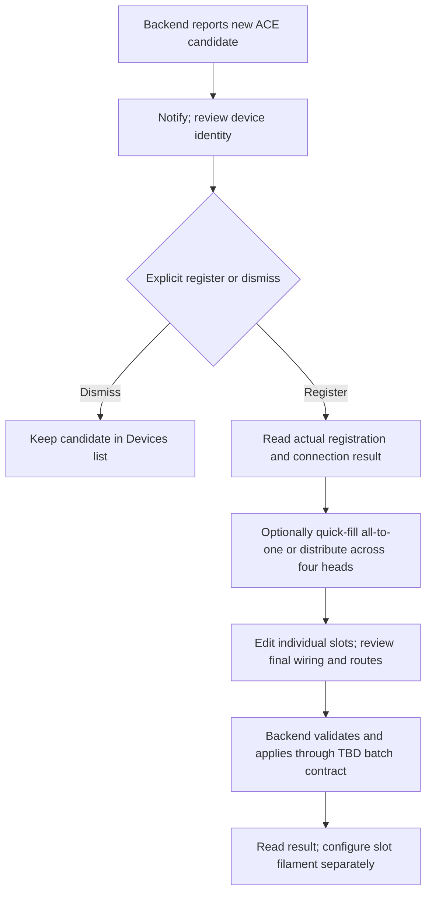
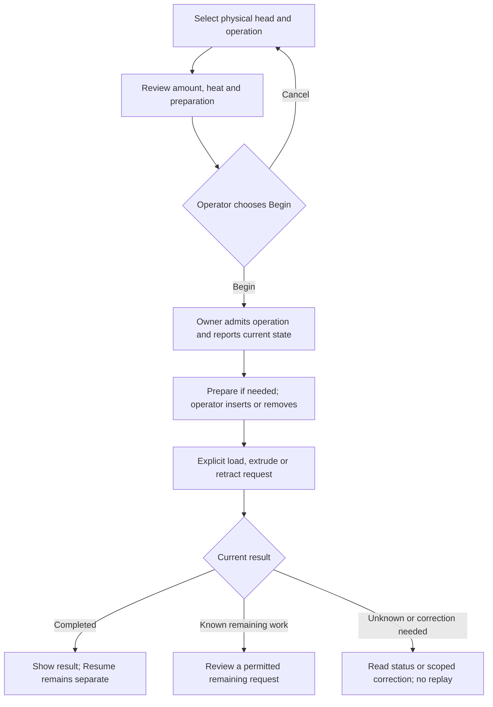
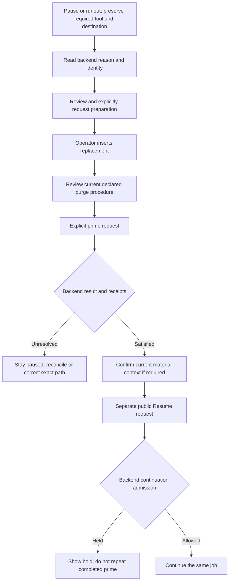
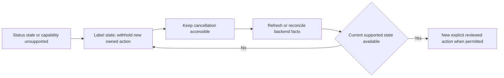

# Wondermaker+ unified screen plan

## Active follow-up — 14 November 2026

The busy/admission audit inventory, fixes, retained safety holds, and validation
limits are recorded in [the busy-state audit](ui/busy-state-audit.md). The status
latency investigation runs independently of the User2 bottom-Z investigation.

Latest field outcome: User1 confirms docking/release works. User2 confirms
homing and docking/mounting work, and Fluidd is much more responsive after the
memory fix. Their two process samples also showed unchanged PID and RSS.
The reported field motion failures are resolved by operator confirmation.
The busy-state audit and identified corrections are shipped. Remaining local
verification: bed leveling followed by vibration compensation without status
warnings, and observed completion of the remaining calibration options.

- Resolved field incident, evidence retained: User2's idle Fluidd reset after the
  update. Received `moonraker(1).log`: Moonraker stayed running while its event
  loop stalled for 5–17.75 seconds and Klippy requests waited 74–80 seconds.
  Klippy's socket reset at 04:19:18, before the caught network-status command
  error at 04:19:22. Received `klippy(17).log`, confirming fresh Klippy process
  starts at 04:19:30 and 04:25:43 without a logged preceding shutdown. Received
  journal evidence confirming the kernel OOM-killed Klippy at 04:19:17 with
  approximately 320 MB anonymous RSS. User2 confirmed the missing filament
  profile JSON condition. Under deferred cyclic collection, this exact file
  combination reproduces 92.8 MB retained over 1,000 status publications in
  the original helper versus 55 KB with the `253159d` profile snapshot.
  The `f66623b` follow-up also fixes the both-files-absent adoption path.
  See [memory evidence](ui/status-polling-latency.md#legacy-adoption-and-deferred-cyclic-collection).
  User2 confirms successful homing and improved responsiveness after updating;
  the actual GC starvation interval and connection to earlier homing remain
  unmeasured. Moonraker's event loop and Klipper's reactor are separate.
  See [incident evidence](z-recovery-investigation.md#november-15-idle-disconnection--moonraker-log-evidence).
  Reopen on recurrence; extended unattended stability is not yet measured.
- Completed audit scope: every busy/admission state across the touchscreen, request workers,
  backend helpers, and macros. Inventory every setter and consumer; verify
  success, refusal, cancellation, exceptions, timeouts, disconnects, owner/session
  changes, navigation, and restart paths. Include pending receipts and derived
  operation states, not just variables named `busy`. Check whether each state
  needs to block anything at all, and restrict it to the affected operation:
  editing a local filament draft must not block printer movement or calibration.
  Settings saves should be validated atomic metadata transactions with separate
  request tracking; any subsequent physical operation needs fresh admission.
  Distinguish leaked state from deliberate unresolved-motion/fault locks and
  document the explicit recovery path for each retained lock. Add fault-injection
  tests for confirmed gaps; track coverage and remaining unverified paths.
- Investigate the intermittent “Calibration status unavailable” overlay during
  bed leveling on our printer. The panel repeatedly appears and disappears.
  Check status polling, freshness expiry, and calibration-session availability;
  do not hide a real loss of status or imply completion from stale evidence.
  Investigated in parallel while the reported docking/release and bottom-Z
  homing failures retain priority.

Current standalone release status and executable acceptance gates: [standalone validation checklist](ui/standalone-completion.md). Older candidate/status inventories below are historical where superseded by that checklist.

**Release scope — 12 November 2026:** the initial release supports standalone
WM+ without openACE. openACE support is deferred to a subsequent release. The
openACE/ACE workflows and owner-mode acceptance cases below remain the future
integration design; they are not initial-release exit gates. Existing ownership
and unsupported-mode refusals remain required to avoid dispatching standalone
operations into another manager. The standalone checklist above governs release
readiness; this decision does not waive its standalone recovery requirements.

**Working design and evidence inventory — 29 October 2026.** This consolidates
our screen discussions, August mockups, current WM+ patches, installed openACE UI
experiment, and the recovery-ownership review. It is a proposal for review, not
permission to deploy or move the printer.

Open the [interactive review](ui/review.html) to filter screens by disposition,
switch standalone/openACE/unavailable views, inspect workflows and revisit the
historical mockups. Its controls only navigate this document; it has no printer
connection. The tables below and review share [structured plan data](ui/plan-data.json).

Review the [clickable 800 × 480 screen mockups](ui/mockups.html) or the
[screen image gallery](ui/mockups/index.html). These use fictional data and
simulated actions; backend commands marked TBD are not implemented.

**Readiness review:** [Workflow/state audit and complete transition map](ui/workflow-review.md),
[openACE implemented/planned capability audit](ui/openace-capability-review.md),
and [WM+ implementation gap audit](ui/wmplus-capability-review.md).
The workflow review is authoritative where older prose/diagrams below disagree.
The mockups are visual prototypes, not a complete operational specification.

## Current-screen review

See the [observed WM screens alongside proposed changes](ui/current-screens.html).
A navigation-only walkthrough on 29 October captured Home, Filament, the material
list, XYZ, Video and General on the current installation. WM+ remained installed;
this is not a clean-stock test. The printer was left on Home. No movement,
heating, filament operations or service restarts were requested.

The revised mocks preserve the Home / Files / Settings shell. The head-temperature
panel now opens toolhead management; the bottom-right filament mini-view opens
filament/source management. These are proposed WM+ routes; the observed stock
head panel opens temperature controls.

### 30 October design decisions

Latest interaction refinements:

- Keep XYZ / Filament / Video / Wi-Fi / General visible in the Settings shell;
  preserve Home / Files / Settings in the sidebar.
- Manual Extrude/Retract submits directly with the selected distance. Show a
  spinner/busy state on the pressed button, prevent overlapping requests, and
  follow backend completion/failure/unknown state. No review dialog is required;
  owner, heater and operation admission still apply. Demo timing is illustrative.
- Filament information cards have a corner edit icon for loaded and empty heads.
  Do not use a separate Edit filament button. Keep all controls above the footer.
- No standalone touchscreen Filament Library is planned. Imported profile data
  feeds the editor's brand/material choices; USB/import review remains a separate
  action, with format and selection/precedence behavior still TBD.

- Home head-temperature panel opens Toolhead management. The mini filament view
  opens Filament / ACE Slots and shows an alert icon for newly detected hardware.
- Toolhead view has four head tabs. Left: loaded filament brand/material/colour
  and Unload; empty heads show Load and Edit filament. Right: distance, temperature,
  up-arrow Retract and down-arrow Extrude. Loaded state must come from backend
  evidence, not merely a configured slot identity.
- Filament management contains identity/source editing, not physical movement.
  ACE units are scrollable titled groups of four slots with head-filter tabs.
  Nonmatching slots fade. Each head without an ACE slot has one External filament
  to configure. Without ACE, four External columns appear in head order 1–4.
- New discovery adds Adopt near the top of this page; no separate ACE devices
  page is needed. Adoption is not automatic mapping or loading.
- Unit details owns all head assignments: tap a slot to choose its head. Quick
  assignments fill the same draft. Save & exit returns to filament management.
  The separate Slot Assignments view is removed. Filament identity editor has no
  physical-head selector.
- Unit details has confirmed Remove, disabled for active and paused prints.
  Requested behavior: delete its associated T entries and renumber remaining tools.
  This is a backend-owned transaction requiring a new agreed contract; the screen
  cannot safely emulate it with independent deletes/renumbers. Show old/new routes,
  invalidate stale preview selections, and retain physical/recovery evidence.
  Explicit removal is the exception to preserving existing tool numbers during
  ordinary assignment edits. It never changes a frozen active-print map.
- On-printer identity is brand (always including Generic), material and palette.
  Advanced profiles, exact colours and PA stay remote/command based.
- Profile import uses USB or a command upload, with JSON or ZIP and a known,
  versioned schema TBD. Direct Orca format support remains undecided because
  upstream schema changes can break it. Future AFC-compatible remote interaction
  is distinct from this file format and remains TBD.
- Preview shows sliced colour/material/optional brand opposite chosen source
  colour and Tool / ACE / Slot description. Tap the source to open grouped units
  plus External sources, tap a slot to select and dismiss. Selection is not proof
  of compatibility; backend admission still gates Start. Tap thumbnail to enlarge;
  X closes it.

## 1. Decisions this plan proposes

Ship **one maintained WM+ screen implementation with progressive enhancement**.
Keep the useful vendor navigation, status, file browser and general settings.
Replace the filament workspace and print-preview content where the stock model
is too limited. Route owner-dependent actions before stock workers can emit a
heat/tool/move prefix. Add openACE capabilities to the same screens rather than
shipping a separate openACE skin or maintaining two recovery workflows.

| Term | Meaning |
|---|---|
| Keep | Retain the vendor screen and its unrelated behavior |
| Overlay | Keep the vendor screen and add bounded WM+ status/controls without obscuring its controls |
| Override | Keep presentation but replace a specific action/worker boundary with the appropriate owner |
| Replace | Own the content and its action dispatch; retain appropriate vendor shell/navigation |
| New view | Add an owned page, dialog or step within this same navigation system |

These are proposed final dispositions. Current modifications are recorded
separately below; an overlay demonstrated with fake data is not a completed
replacement.

### Settled constraints versus proposed implementation

The owner has asked for a single progressively enhanced UI. Standalone stock
runout behavior is retained **for now**; manual standalone load/extrude/unload
controls are future work. With openACE, there is one recovery owner and no added
stock preparation around its commands. The screen map, page layout and phase
ordering in this plan are recommendations, not claims of prior approval.

## 2. Where we actually stand

No printer navigation, motion or service restart was performed to prepare this
plan. State below comes from retained source, published-release records and the
last supplied deployment/readiness evidence; it is not a fresh live inspection.

| Layer | Current evidence | What it does not establish |
|---|---|---|
| Published WM+ `fw-1.1.13-r2` | Stock visual UI with targeted behavior fixes, macros and the remote touchscreen bridge | A delivered full filament/print-preview redesign |
| August `screen-mods` worktree | On-device demo mapping/preview/colour/filament-panel iterations, using demo data and incomplete action integration | Current firmware compatibility, production mapping, or qualified physical actions |
| Native openACE V14 | Last supplied installation receipt identifies combined SO `1a8e768a…`; source implements alert/confirmation, setup and manual reload panels | The readiness record still reports the real badge absent. Installed code and passing tests are not a usable/accepted screen feature |
| Recovery guard revision 2 | V14-preserving candidate `b99a0a26…` guards both automatic recovery workers; 328 software tests pass | Activation, fresh target dependencies, physical acceptance, or permission to restart the paused print |
| Standalone common filament workspace | Plan and historical visual ideas | A new standalone operation/status API or completed general extrude/retract UI |

The working repository's older native UI bundle is not the installed V14 truth.
Before release integration, reconcile the reviewed installed UI source into one
maintained package; do not reseal or deploy the older bundle. Retain exact source
and artifact evidence and separate physical acceptance from software tests.

### Existing openACE software is narrower than the target UI

The V14 source contains:

- A material-change alert and **current-context confirmation**; approval is not Resume.
- A paused direct-head reload panel using reviewed preparation, procedure planning
  and explicit inserted/prime requests. This includes ordinary pauses without an
  M600 alert and openACE with zero ACE units.
- Setup pages for devices, virtual tool routes, source/head settings and basic
  material/temperature/colour text edits, with Review/Apply and backend admission.
- Freshness/session/context and unknown-delivery handling; stock Print/Stop
  footprints and foreign modals are protected by the rendering model.

These are software capabilities, not accepted physical controls. The manual
panel currently has bounded **integer** procedures, not arbitrary fractional
requests, a complete rich material editor, an idle standalone workflow, or a
universal correction/REMOVED screen. Backend recovery console functions should
not be described as already delivered on the touchscreen.

## 3. Stock WM GUI inventory

Baseline is the reviewed System 1.1.13 client. The inventory combines native screen
symbols, reviewed command paths, earlier screen observations and mockup notes.
Presence in the binary proves implementation, not that every page is visible in
all models, maintenance modes or print states. First-run/factory/account access
and every runtime menu restriction still need a nonmoving, attended inventory.

**Correction to earlier shorthand:** stock has TAKE / RELEASE / UNLOAD / LOAD
and a limited material/colour picker. TAKE/RELEASE concerns head pickup/docking;
LOAD/UNLOAD concerns filament. What we lack is a coherent shared manual
extrude/retract and recovery flow, not all filament buttons. Stock preset loading
is not a free-form extrusion control or an openACE preparation receipt.

<!-- BEGIN stock -->

| ID | Stock surface | Implemented stock features / limits |
| --- | --- | --- |
| S01 | Home / machine status | Status, four head temperatures, bed/chamber status, quick controls and a bottom-right four-colour filament mini-view button opening filament configuration (operator-confirmed route). |
| S02 | Files / USB / print history | Local files, USB files and history pages exist. File selection leads to preview. |
| S03 | Print preview / filament mapping | Thumbnail/estimate, four-entry filament mapping, bed-leveling and timelapse options; stock colour-match prompt. |
| S04 | Active print / pause / resume / cancel | Progress, pause/resume and stop/cancel controls; stock recovery preparation can run around Resume. |
| S05 | XYZ / homing / physical-head actions | Movement page, jogging/homing and physical tool actions exist; exact visible menu states need a fresh inventory. |
| S06 | Filament / head cards and actions | Four head cards and TAKE / RELEASE / UNLOAD / LOAD actions; stock material and colour selection. Preset loading is not a general extrude/retract workflow. |
| S07 | Colour and material pickers | Vendor palette and fixed material list. Stock storage is limited and does not provide arbitrary material policy. |
| S08 | Camera / video / timelapse | Settings / Video is a timelapse-file thumbnail gallery with FORMAT / EDIT and page arrows (observed live). Print-preview timelapse options and top-bar camera controls are separate surfaces; their current behavior was not exercised. |
| S09 | Wi-Fi / access point | WLAN and AP setup pages and first-run Wi-Fi guidance. |
| S10 | General / language / sleep / about / user / FAQ | General/system, language, sleep, about, user and FAQ pages exist. Some are model/account gated; detailed controls are not all runtime-verified. |
| S11 | Calibration / nozzle configuration / self-check | Probe calibration, nozzle type/flow/settings, calibration guide and self-check pages exist. |
| S12 | First-run / onboarding | Language, Wi-Fi, bed-unlock, filament/nozzle setup and calibration guidance. |
| S13 | Runout / tangle / material-change prompts | Fault warnings, replacement popup and automatic resume worker; stock may substitute a matching head and purge 100 mm. |
| S14 | Power-loss recovery | Vendor recovery prompt and native recovery startup sequence. |
| S15 | Factory / hardware topology / service screens | Factory/service and nozzle/head setup functions exist; some are hidden or maintenance-only. |

<!-- END stock -->

Stock runout behavior is particularly important: a separate popup callback can
heat, home X/Y, travel and feed 100 mm; a state-check-queued resume worker can
substitute a matching head, rewrite mappings, purge and issue RESUME. The exact
incident's button-event origin remains unestablished. These are separate from
sensor collection and the initial runout/tangle PAUSE. See section 8.

## 4. Changes already made, and changes only prepared

Statuses deliberately distinguish **released**, **installed but unaccepted**,
**candidate**, **historical demo**, **proposed**, and **deferred**. The installed
native panels are not advertised as operator-available while their entry remains
unaccepted. Basic identity editing in native software is not the proposed rich editor.

<!-- BEGIN features -->

| ID | Feature | Status | Current scope |
| --- | --- | --- | --- |
| F01 | Remote touchscreen in Fluidd | released | Framebuffer mirror, remote touch, 5 fps cap, changed-row stream and decode fix. |
| F02 | Wi-Fi / fan / recovery / Resume command fixes | released | Behavior patches and macro changes; broad stock visual layout remains. |
| F03 | Native material alert and bound confirmation | installed-unaccepted | V14 software exists and the SO was installed in the supplied receipt. Entry badge/physical interaction remain unaccepted. |
| F04 | Native openACE setup pages | installed-unaccepted | Devices, tools, sources, heads and basic identity edits exist in software; not visually accepted. |
| F05 | Paused manual reload panel | installed-unaccepted | V14 implements reviewed prepare / declare procedure / inserted-prime requests, with bounded integer amounts. Physical acceptance remains open. |
| F06 | Both automatic recovery-worker guards | candidate | Both stock automatic recovery workers are intercepted. Same-head physical runout/replacement/Resume accepted through r195; cross-head return, no-Z-motion and refusal branches have execution-test coverage. No physical cross-head qualification is claimed. |
| F07 | Standalone explicit load / unload workspace | proposed | Stock preset LOAD/UNLOAD exists; a new shared WM+ workflow does not. |
| F08 | Standalone measured-request extrude / retract controls | proposed | No accepted general amount/speed/manual-progress interface is established by this inventory. |
| F09 | Rich identity / colour / material editor | historical | Hex palette, material/hardware constraints and true-colour head cards were demoed. V14 basic text edits are narrower. |
| F10 | Print-start replacement and all-filament mapping | historical | Earlier replacement showed demo metadata and logged Start/Confirm. Not integrated with current mapping authority. |
| F11 | Operation Review / progress / unknown outcome | proposed | V14 has context/review and delivery states for selected actions, not one universal standalone+openACE workflow. |
| F12 | Scoped correction / receipt reconciliation screen | proposed | Backend console workflows exist. V14 manual panel has no generic recovery/REMOVED action. |
| F13 | Capability and ownership status | proposed | Existing native model detects sessions/capabilities; no accepted unified user-facing status page. |
| F14 | ACE device / tool / source management integration | installed-unaccepted | Bounded native management commands exist in V14 software. Backend acceptance and screen acceptance are separate. |
| F15 | Explicit guided standalone paused recovery | candidate | Managed standalone paused service and guarded Resume are implemented/deployed. Attended cross-head recovery remains open; legacy macros and PLR are separate audited gaps. |
| F16 | Object-aware travel planning | deferred | Clearance moves exist; no general object/order-aware planner is established. |
| F17 | New-unit notifications and registration lifecycle | proposed | Discovery/registration/removal/replacement acceptance interfaces exist; the shared notification lifecycle is not delivered. |
| F18 | Slot/head quick assignment and editable grid | proposed | Individual tool-route mapping exists; no atomic preset contract is established here. |
| F19 | Per-slot brand/material/PA selectors | proposed | Basic identity fields exist; PA persistence/application and profile catalogue APIs are TBD. |
| F20 | Orca / Spoolman profile library | deferred | Orca lane field edits and optional spool_id exist; full profile transfer, synchronization and enumeration do not follow from them. |
| F21 | Per-tool temperature and operation stop | proposed | Physical heater endpoints exist; unified owner-aware policy and stop/cancel capabilities are not fully specified. |
| F22 | Optional ACE telemetry / drying UI | deferred | Not established as a supported UI or public backend contract by this inventory. |

<!-- END features -->

Macro changes such as print-end clearance/wiping, tip shaping, probing reference,
and explanatory messages change the behavior invoked from the screen. They are
not additional screens. Likewise, Wi-Fi/fan fixes and recovery guards are behavior
patches; the Fluidd mirror is access to the physical screen, not a new native GUI.

## 5. Screen-by-screen target disposition

Keep the familiar Home / Files / Settings shell. Put the shared Filament workspace
under the existing Filament area and provide a Home entry, rather than showing
both a vendor filament workflow and a competing permanent openACE panel. Transitional
badges can reach the owned flow while its full workspace is being delivered.

<!-- BEGIN dispositions -->

| ID | Surface | Primary disposition | Target change |
| --- | --- | --- | --- |
| S01 | Home / machine status | overlay | Keep the stock Home / Files / Settings shell. Head-temperature panel opens toolhead management; bottom-right filament mini-view opens filament/ACE slots. For ACE, one small outlined unit rectangle contains four coloured slot boxes; no ACE uses four manual-filament indicators. |
| S02 | Files / USB / print history | keep | Keep browsing. Route selection and Re-print from completion/stopped dialogs through a fresh shared print-preview review; never replay a stored map directly. |
| S03 | Print preview / filament mapping | replace | Managed preview is the common entry for new prints and Re-print. Re-read file identity, usage, mappings and current loaded sources before an explicit PRINT submission. |
| S04 | Active print / pause / resume / cancel | overlay | Keep global Pause/Resume/Cancel access. Recovery preparation belongs to the selected backend. Print cancellation and operation Stop have distinct outcomes; reconcile queued service work before allowing later motion. |
| S05 | XYZ / homing / physical-head actions | override | Retain layout; put motion/head-selection commands through the selected owner with explicit consequences and state admission. |
| S06 | Filament / head cards and actions | replace | Filament / ACE Slots shows grouped ACE units and an External slot per head lacking an ACE route. Discovery Adopt button lives near the top; no separate device-list page. No movement buttons. Unit details alone edits slot/head assignments; filament editor only edits identity. Keep the existing Settings top tabs visible. Toolhead loaded/empty identity card has a corner edit icon, not a separate Edit filament button. Extrude/Retract operates directly with busy feedback. |
| S07 | Colour and material pickers | replace | Simple on-printer editor: brand with Generic always available, material and preset colour palette. Keep exact colours, profile details, temperature metadata and PA editing in remote/command interfaces. Future Orca integration should use an AFC-compatible protocol; exact contract TBD. |
| S08 | Camera / video / timelapse | keep | Keep physical camera/settings pages. Explain touchscreen mirror versus print camera in documentation and setup. |
| S09 | Wi-Fi / access point | keep | Keep vendor UI and corrected retry behavior. |
| S10 | General / language / sleep / about / user / FAQ | keep | Keep. Add a WM+ version/capability/diagnostics link rather than replacing unrelated settings. |
| S11 | Calibration / nozzle configuration / self-check | override | Keep calibration screens with backend-owned physical-head preparation and session-bound editing. Admit before UI/motion mutation; acknowledge ACCEPT before SAVE_CONFIG and restart. Do not requalify unchanged measurement algorithms. |
| S12 | First-run / onboarding | override | Keep language/network/hardware steps; route owned filament steps to the shared reviewed workflow before stock prefixes execute. |
| S13 | Runout / tangle / material-change prompts | replace | Replace owned filament recovery dialogs with an explicit shared flow. Preserve unrelated vendor warnings; no broad popup suppression. |
| S14 | Power-loss recovery | override | Keep the recovery entry point. Admit current filament/source readiness, operation journals, owner and checkpoint context before any stock preparation. Retain verified mesh/offset/file safeguards; a richer replacement PLR UI remains separate work. |
| S15 | Factory / hardware topology / service screens | override | Keep controlled service access, but override conflicting factory preparation, jog/save, topology/reset and restart actions. Preserve calibration transactionally and revalidate installed contracts before enabling managed controls. |

<!-- END dispositions -->

The [interactive inventory](ui/review.html#screens) expands each row into its
stock behavior, present implementation, target controls and mode-specific behavior.

### Capability and owner matrix

| State | Presentation | Material/motion owner | Fallback |
|---|---|---|---|
| Startup / not yet established | Loading capabilities; unrelated stock settings still usable | Not established | No new owner-dependent physical action |
| Confirmed no openACE | Shared standalone screens; hide ACE-specific settings | Reviewed WM+ standalone command path, with legacy stock behavior retained until replacement is qualified | Only supported standalone functions; no invented virtual routing |
| openACE present, including zero units | Same screens with backend tools/sources/recovery and permitted actions | Public openACE commands and backend state | No stock heat/T/XY/purge prefix around them |
| openACE present but capability/version unsupported | Explain unsupported feature; retain unrelated UI | Backend ownership remains | Do not treat missing capability as absent openACE |
| Previously detected openACE becomes stale/unreachable | Stale labels and unavailable actions; preserve cancellation access | Ownership cannot silently switch | Refresh/reconcile; no stock physical fallback or command replay |

A confirmed absence response is different from an error, timeout or malformed
response. An active job's owner/destination cannot switch because the display
loses its connection. Page availability must follow advertised action capability
and job state, not the mere presence of files or the number of ACE devices.

### One implementation, different adapters

Shared components should cover head/tool cards, material identity, operation
review, progress/unknown outcome, confirmation and error details. A capability
adapter chooses public openACE commands when available, or the reviewed standalone
WM+ command contract as it is built. The adapter must not duplicate routing,
purge accounting, physical completion or persistence.

The standalone contract is **new work**, not a claim that existing opaque
LOAD/EXTRUDE macros provide typed progress/receipts. A standalone operation may
initially offer only trustworthy coarse status; it must not fabricate measured
filament movement. Do not create a parallel openACE state machine or second
identity/journal store merely to make the UI look complete.

Physical-head labels and virtual tools must be distinct, for example
`Tool T4 · Head 4 (h3) · hand-fed`. A screen's physical index must never become a
virtual `T<n>` by accident. Show operation consequences in plain language; raw
macro names, hook addresses and implementation detail belong in diagnostics.

## 6. New owned views and features

### Explicit openACE and per-tool requirements

The shared UI must support the requirements below, rather than merely showing
openACE status. **A backend command not yet defined is TBD.** Missing APIs do not
remove a requirement, justify a guessed command, or permit falling back to a
stock worker/raw G-code path under openACE. Existing public commands are evidence
of narrower backend capabilities, not a promise that every proposed workflow is
already implemented. The review companion has a dedicated
[requirements and API gaps tab](ui/review.html#requirements).

<!-- BEGIN requirements -->

| ID | Requirement | User behavior | Backend / API status |
| --- | --- | --- | --- |
| R01 | Notify when a new ACE unit is detected | New unit discovery adds Adopt near the top of Filament / ACE Slots and an alert icon on the home mini-view. No separate device-list view. Discovery does not adopt, map or load automatically. | Discovery/status and explicit scan exist; notification UI and deduplication are planned. |
| R02 | Adopt / register an ACE unit | Review the selected hardware, assign a friendly name and explicitly register it. Adoption wording is provisional. Reconnecting a known unit is not a new adoption. | OPENACE_UNIT_ADD exists; exact discovery/identity context must remain current. |
| R03 | Remove ACE unit and renumber tools | Unit details has Remove with confirmation. Disable for active or paused prints. Remove associated T entries and renumber remaining tools as one backend-owned operation; show old/new mapping and invalidate stale preview assignments. Do not unload or discard physical recovery evidence. | Existing removal interfaces do not establish this transaction contract. Atomic deletion, renumbering, active-job admission, failure handling and readback are TBD with openACE. |
| R04 | Assign slots to physical heads | One editable slot-to-physical-head assignment grid. Edit any row directly, including after quick assignment. Show the corresponding virtual tool route; one slot cannot fork to multiple heads. | OPENACE_MAP_TOOL / UNMAP_TOOL exist; the backend derives routes from tool definitions, not a second UI wiring map. |
| R05 | Quick assign: all slots to chosen head | Choose one physical head and fill every slot in the selected unit draft with that head. Every row remains editable; change one or two assignments before Review/Apply. No immediate backend write or movement. | Existing individual route commands exist; shared draft UI and validated batch/apply semantics are TBD. |
| R06 | Quick assign: distribute across four heads | Fill the same draft by distributing slots in order across physical Heads 1–4. Four slots start one per head; additional slots repeat the order. Custom edits may adjust any rows afterward. Preserve unrelated units/routes. | Draft distribution is UI behavior; backend validation/batch apply is TBD. Do not invent missing configured heads. |
| R07 | Per-slot Brand and material selection | Select Brand, product line/profile and material from a catalogue, with an explicit custom entry when needed. Keep source identity distinct from a physically verified load. | Standalone implementation exists: built-in catalogue, retained brand/material selectors, revision-bound atomic metadata edits and remote AFC-compatible publication. B02 live Save/Cancel/stale-draft and B06 remote round trips are accepted in docs/ui/standalone-completion.md. openACE slot qualification and profile importing are deferred; do not interpret the older TBD as missing standalone persistence. |
| R08 | Per-slot colour picker | On-screen preset colour palette; always offer Generic brand and material choices. Advanced exact colour/profile editing remains remote or command-based. | Standalone swatch/hex picker and metadata persistence implemented; B02 records accepted live color round trips and stale-draft refusal. Preserve custom existing values. openACE slot qualification is deferred. |
| R09 | Remote pressure-advance configuration | Advanced PA settings belong to remote/command interfaces, with applicability and provenance. No PA picker required on the printer touchscreen; backend contract remains TBD. | TBD: no pressure-advance identity/profile command identified in the reviewed openACE API. Persistence, validation and application timing need a contract. |
| R10 | Filament profile import via USB or command upload | USB selection or upload command accepts a single JSON file or ZIP with a known, versioned format TBD. Preview supported declarative fields and conflicts before importing. Direct Orca format support remains an option with upstream-change risk, not the committed format. | TBD: import transport/schema, inheritance resolution, enumeration and backend ownership. Existing Orca lane edits are not full profile upload. |
| R11 | Future Spoolman profile / spool integration | Browse a configured source, distinguish reusable material profiles from individual spool records, select explicitly and retain IDs/provenance. | TBD: connection/import/enumeration and supported field mapping. Existing spool_id metadata is not Spoolman synchronization. |
| R12 | Per-tool Load / Unload | Use the selected virtual tool/source and physical head under openACE; a physical head under standalone WM+. Review preparation, then show current result/holds. | Standalone managed Load/Unload implemented, with metadata draft, XY-only preparation, mounting, heating, insertion/removal, separate loaded flag, purge/wipe and numbered progress. D02/D03/D04 contain accepted baseline evidence; later R21/R27 track adapters and interruption handling. Reconcile remaining original A–G items with later results before claiming complete release acceptance. openACE qualification deferred. |
| R13 | Per-tool Extrude / Retract with selectable steps | Select distance step, direction and applicable speed/temperature. Each explicit press requests one admitted action; show amount and operation status. Manual Extrude/Retract has no review dialog: submit the selected step and show button busy state from backend progress; preserve owner/temperature admission. | Standalone WMP_EXTRUDER_STEP and selectable native controls implemented. C03 records H3 step/readback and modal-state preservation evidence; physical distance and native-dispatch limitations must be reconciled against later evidence, not assumed complete. openACE qualification deferred. |
| R14 | Per-tool temperature controls | Show actual/target temperature. Tapping opens numeric target entry; confirming a target applies heating directly, without a separate Heat button. Setting target zero turns heating off; an X shortcut may do the same. Identify the physical heater; distinguish temporary target changes from saved filament metadata. | Standalone physical heater target/readback implemented. C01 records all-four-head target, numeric-zero, X-off and Home agreement acceptance, including replacement of initial keypad zero. This is idle target-control evidence, not qualification of every material recipe or active-print override. |
| R15 | Unit disconnect, reconnect and replacement status | Distinguish saved registration from current connection and identity acceptance. Show the unit/slots affected; do not erase routes or re-adopt automatically. | Backend status/identity acceptance exists; consolidated notification and operator workflow are planned. |
| R16 | Stop current operation and inspect its result | Separate operation stop/cancel from print cancellation and from emergency shutdown. Show backend-permitted stop, partial result and any recovery hold. | Exact per-operation stop/cancel capabilities are TBD where not advertised; do not invent a universal successful abort. |
| R17 | Profile selection, overrides and applicability | Show whether each value came from imported profile, slot override, head/nozzle calibration, active print or a temporary manual override. Explicit reset-to-profile and conflict review. Distinguish RFID/reported values from manual overrides and resolve incoming changes explicitly. | TBD: common profile schema and precedence; backend/slicer application rules must be agreed before applying PA/temperature automatically. |
| R18 | Head pickup / docking controls | Provide explicit Take head / Dock head separately from filament Load / Unload; show mounted/docked state and the selected destination. | Standalone physical-head Take/Dock implemented with managed receipts, state admission and retained coupling faults. C02 records all-head cold cycles and cross-head selection; current R25 accounts for changed retry guards and accepted camera-observed Take/Dock. Generic mechanical qualification is outside release scope. |
| R19 | Optional later: ACE telemetry / drying controls | Where hardware/backend capabilities exist, show unit health, temperature/humidity or drying state, and explicit drying start/stop/settings. This is later scope, not a prerequisite for the core filament UI. | TBD capability and command contracts; do not imply present backend or screen support. |
| R20 | Managed Re-print entry | Re-print opens a fresh managed preview for the same file. Explicit PRINT uses current source identities and mapping; old selections are drafts, never authority. | Current standalone evidence (12 November, installed r178): Real completed-popup handoff to managed preview accepted r134; metadata-free PRINT refusal and CANCEL verified; stopped-filename fallback host-tested and installed Still required / qualification limits: None for the supported standalone routes: both known direct stop-worker callers are intercepted; last-object exclusion accepted r169. Other-owner stopped-popup qualification is deferred Authoritative detailed queue and historical evidence: docs/ui/standalone-completion.md. |
| R21 | One filament operation API | Supported legacy Load/Unload and related service entry points use the managed operation contract or refuse before side effects with a clear route to it. Keep explicit physical-head addressing and owner-specific adapters. | Current standalone evidence (12 November, installed r178): Standalone managed service and ACE-source owner adapters installed; direct external Load exercised with the owner offline; unsupported owner external Unload refuses before dispatch Still required / qualification limits: None for the standalone legacy adapters. External Unload under openACE and native/live openACE qualification move to the subsequent release; standalone service-interruption validation remains tracked under R27 Authoritative detailed queue and historical evidence: docs/ui/standalone-completion.md. |
| R22 | Managed power-loss recovery admission | Before heating, tool selection or motion, validate checkpoint/file, calibration/mesh/map, current filament readiness, operation uncertainty and owner. Offer only recovery actions supported by that owner. | Current standalone evidence (12 November, installed r178): Local durable execution/attempt handling, preparation through purge/wipe/return/parser restore; optional private continuation through exact-file/routes/accounting and durable worker activation; local runtime outcome handling, job-bound pre-enqueue deposition recording, clearance admission guards, resumed observer restoration, immutable-request Continue command, reactor STOP endpoint and native early selection hook; native receiver, independent transports, numbered progress/STOP panel and explicit resolution review/confirmation connected locally; post-restart recovery API coverage; r149 native Continue, visible stages/temperatures, clearance/home/heat and DISCARD→CONFIRM accepted; exact original bytes verified in archive; r151 native Continue through all stages and actual resumed print completion accepted; r153 native STOP→DISCARD→CONFIRM→restart accepted; r156 original-prompt Cancel→REVIEW→CANCEL and Cancel→REVIEW→DISCARD→restart accepted with exact nine-record archive and no discard motion Still required / qualification limits: r167 native interrupted-resume REVIEW→CONFIRM accepted, recording newer completed position 4924 without motion, heating or print resumption. Both implemented resolution actions have native acceptance: failed-attempt abandon r149 and interrupted-continuation reconcile r167. Remaining: native incompatible-record retirement presentation/confirmation. Persistence-failure and lost-response branches have host/native-worker coverage, not physical fault injection. openACE owner qualification is deferred. Historical formats cannot safely auto-migrate; their public discard/archive path is host-verified. Do not repeat accepted continuation or discard flows without a relevant change Authoritative detailed queue and historical evidence: docs/ui/standalone-completion.md. |
| R23 | Transactional reset and topology changes | Factory reset / clean return-to-stock support is deferred from this release; retain the installed reset guard. In-scope discovery/topology changes must preserve calibration and managed records and refuse unsupported transitions before publication. | Current standalone evidence (12 November, installed r178): Joint candidate/journal/rollback and stale-session guards tested; changed mapping refuses without calibration provenance. Reset Confirm refusal, opaque notice and CLOSE accepted r124; r143 reconfirmed refusal with 19 unchanged tracked files Still required / qualification limits: Changed identification and intercepted discovery/config-save contracts reviewed against existing assertions and accepted results (evidence map below); no uncovered functional case identified for the supported unchanged-mapping route and changed-mapping refusal. Factory reset remains deferred with its accepted guard. Hardware remapping without independent calibration provenance remains unsupported; no new physical topology support, model-change qualification, or arbitrary external-shell validation is required for this UI release. Authoritative detailed queue and historical evidence: docs/ui/standalone-completion.md. |
| R24 | Session-bound calibration editors | Admit factory preparation/jog before mutating display or moving. Bind edits to the backend session; save only after accepted calibration result. Keep Close/cancellation responsive and wait off the GUI thread. Separate pre-action refusal from uncertain execution. Provide bounded failed-preparation cleanup and explicit snapshot-bound review of concurrent offset edits; never overwrite newer configuration or infer save success from inactive status. | Current standalone evidence (12 November, installed r178): Managed editor installed. Native preparation START→STOP accepted r143 after fixing the actual HTTP route allowlist; terminal aborted, no active helper/pending save or config change. Native ABORT accepted r142. Factory/knife/password-success guards installed r142 and retained; native START→JOG→ACCEPT→DISCARD accepted r155 with unchanged config and no pending save Still required / qualification limits: Changed save/restart and REVIEW/ACK/RETAIN functional coverage reviewed and accounted for (evidence map below); no uncovered functional case identified. Native pixel-layout inspection of save-review controls remains separate; host/native tests establish rendering properties and dispatch, not a live screenshot. Fresh physical calibration and Factory/Service password access are not prerequisites. No repeat of accepted START/STOP or ACCEPT/DISCARD. Authoritative detailed queue and historical evidence: docs/ui/standalone-completion.md. |
| R25 | Managed failure retries | Retain fault evidence and determine physical attachment before offering a scoped retry. Propagate coupling homing errors before zeroing/post-stroke motion. Check session/generation ownership at each actuator boundary; never clear/home/retry uncertain coupling automatically. Confirm fault persistence or shut down. Preserve successful Take/Dock travel and configured speeds. | Current standalone evidence (12 November, installed r178): Single-attempt coupling guards installed; stale-session refusal verified; direct nonzero-fault action guards deployed r140. Camera-observed H4 Dock and Take both accepted on 12 November Still required / qualification limits: No general mechanical qualification or deliberate physical failure test is required. Changed single-attempt/error-propagation and durable-fault behavior have actuator/macro tests; successful Take/Dock is already accepted. Raw vendor-console bypass is a documented boundary, not a new sandbox requirement. Reopen only for an identified gap in the changed guard or a new failure. Authoritative detailed queue and historical evidence: docs/ui/standalone-completion.md. |
| R26 | Restart ownership and consequences | Treat screen/service restart as a machine-state operation. Admit using fresh job and managed operation state, preserve durable evidence, and require explicit recovery after an interrupted operation. | Current standalone evidence (12 November, installed r178): Installed r121 Ready-state guard and unresolved-result hold; exact startup shell restart suppressed and built wrapper tested; installer explicitly restarts the Klipper process and verifies changed PID, loaded protocols and stable readiness; r121 idle activation and preservation passed; r174 controlled OS reboot preserved all six tracked files, identities and loaded flags, with successful defaults migration before Klipper and screen startup Still required / qualification limits: No further generic restart or stock-warning interaction test is required. The changed guard is covered by the joined ARM warning/retained-dispatcher tests; actual restart preservation passed r174 and interrupted Load recovery passed r177. Any remaining gap must name the changed ownership/persistence branch. Configuration-writer coverage is tracked under R23, not another reboot campaign. Authoritative detailed queue and historical evidence: docs/ui/standalone-completion.md. |
| R27 | Print Cancel during managed service | Keep print cancellation available; reconcile the in-flight filament/tool operation, queued commands, heater cleanup and durable partial outcome before any later action. Never describe print Cancel as an instantaneous emergency stop. | Current standalone evidence (12 November, installed r178): Native and remote Cancel accepted with six completed stages; numbered colors, summary and CLOSE accepted through r139. All five active 40 C heater targets cleared by Cancel. r141 remote-start cancellation accepted without backup-write/stale-generation notifications. Native harness verifies disconnect/stale-click, retained widgets, Close/reopen and single confirmed cleanup. r169 genuine pending cancellation interrupted by service stop restored unknown; native REVIEW → CONFIRM acknowledged verified completion without commands, preserving filament state Still required / qualification limits: Changed procedure STOP accepted with one 80 ms native injected tap in r179 on installed r178; interrupted Load RECOVER accepted r177, and interrupted cancellation REVIEW/CONFIRM accepted r169/r170. Physical quick-finger-tap feedback remains relevant to the changed input/refresh code. No unnamed additional interruption matrix or repetition of ordinary Cancel/load/unload is required. Authoritative detailed queue and historical evidence: docs/ui/standalone-completion.md. |

<!-- END requirements -->

### Audit decisions — 11 November 2026

These findings extend the managed design; they do not authorize changing unrelated
stock behavior or treating local tests as printer acceptance.

- **One recovery owner (R20–R22/R27):** Re-print, legacy filament actions, runout,
  power-loss Continue, later Resume and print Cancel must enter the confirmed
  owner's workflow before stock preparation, heating, movement or cleanup.
  Status sync and reconnect must never start or replay those actions.
- **Configuration preservation (R23):** discovery can overwrite a template before
  the save-config helper runs. Protect the entire caller/write sequence, not only
  that helper. Factory restore can leave mixed files after a failed copy. Validate
  and journal the complete write set, preserve exact originals and concurrent
  edits, and verify the loaded configuration after restart.
- **Calibration provenance (R23):** distinguish correcting a wrong assignment
  from moving physical heads. Current UUID order alone cannot establish who owns
  historical PID/nozzle calibration. Keep dock coordinates with docks; explicitly
  review reference-head offsets, mesh context and other calibration records.
  A refusal of ambiguous migration is interim protection, not a finished workflow.
- **Editor and retry boundaries (R24/R25):** admit preparation/jog before UI or
  machine mutation, bind saves to accepted session results, and propagate actuator
  failures. Do not conceal uncertain coupling with nested clear/home/retry loops.
- **Restart boundaries (R26):** guard each caller using fresh state. A backend
  command guard cannot stop service-manager restarts or undo a preceding config
  write. Preserve interrupted-operation evidence and provide explicit recovery.

The current implementation and remaining acceptance gates are tracked in
[the completion checklist](ui/standalone-completion.md#current-audit-follow-up--11-november).
USB/profile import stays deferred. Accepted unaffected load/unload, docking and
stock behaviors are not added back to the test queue.

### Deployment finding and acceptance boundary — 11 November

The r120/r121 qualification adds a concrete requirement to R26: deploying changed
Python extras requires a **new Klipper process**. In the retained vendor runtime,
`FIRMWARE_RESTART` rebuilds the printer inside the same process and can leave the
old helper modules imported. Deployment must verify a changed positive process ID,
stable Ready and the expected loaded protocols before enabling the new client.
A lost restart acknowledgement requires observation, not automatic resubmission.

r121 passed that idle activation gate, stale-session refusal checks and readback
preservation of PID, mesh, offsets, travel/wipe settings and managed filament state.
This closes those specific deployment checks only. Native workflow, physical
recovery, supported-owner and remaining configuration-writer checks remain open
under R20–R27. Keep historical evidence, but use the current checklist for status.

### Calibration and restart findings incorporated — 11 November

These are requirements for the affected stock routes, not a broader factory UI
redesign. The implementation status is separate from the acceptance gates.

- **Acceptance must be proven by the original finalizer (R24).** Stock ACCEPT can
  return normally after refusal; success, refusal and abort all clear active status.
  Bind a one-use save receipt to the backend session and exact probe helper, and
  issue it only after a non-null accepted position and successful finalization.
  Neither HTTP success nor inactive status authorizes SAVE_CONFIG.
- **Own the staged value, not all pending configuration (R23/R24).** Capture the
  editor's probe offset. SAVE must refuse unrelated pending changes. DISCARD may
  restore only its own unchanged value, preserving other edits; a concurrent edit
  of that value requires explicit conflict resolution. Restart admission alone
  cannot prevent a configuration write that already happened.
- **Keep delivery separate from GUI and status (R24).** Use retained controls and
  background delivery, allow one outstanding action, and wait for the matching
  backend receipt. Do not replay uncertain jog/accept/save requests. Changed
  sessions invalidate controls. Preparation STOP, reopening a completed editor and
  failed/unknown-result resolution each need explicit lifecycle handling; a
  background sender alone does not provide cancellation.
- **Separate screen reconnect from backend restart (R26).** Suppress only the
  verified startup restart call. Installation requests its own admitted restart
  and verifies the transition and readiness. Warning callbacks, external service
  restarts and configuration writers remain separate boundaries to audit.

The backend receipt/configuration safeguards and native projection/controller are
local and undeployed. Sender and runtime lifecycle tests have passed; Maintenance,
Factory probe, direct page entry and both legacy editor callbacks now route to
the managed panel in the local candidate. Confirmed completion permits an explicit new editor request. Installed r119 does not include these
new editor or startup changes. No physical calibration or restart qualification is
implied. Preserve previously accepted results and test only changed paths.

### Failure cleanup and conflicting edits — audit follow-up

The calibration audit adds the following explicit R24 lifecycle requirements:

- **STOP is intent, not completion.** A separate transport must deliver STOP while
  preparation is blocked. Stop at preparation checkpoints, drain already accepted
  motion, then abort only the exact owned helper. Lost replies, machine faults or
  replaced helpers retain uncertainty; neither closing the panel nor a successful
  HTTP response establishes that motion stopped.
- **Failed preparation needs a bounded exit.** If the owned helper survives, offer
  cleanup-only ABORT after checking its session and registered handlers again after
  the drain. If no helper was created, DISCARD may retire the failed attempt only
  when probe handlers are absent, probe status is inactive and the pending/autosave
  snapshot remains unchanged. Neither path permits acceptance or saving.
- **Separate refusal from uncertain execution.** A request rejected before side
  effects records its sequence and reason while preserving the editor phase. The
  UI settles that request without resubmitting it. A failure after dispatch stays
  uncertain unless authoritative evidence resolves it.
- **Concurrent edits require review, never rollback over newer data.** If another
  writer changes the owned offset, show the editor's accepted value and the current
  staged value. Plan an explicit KEEP action bound to the complete reviewed pending
  configuration snapshot. KEEP retires the editor's ownership while leaving that
  configuration untouched; it does not save it or prove calibration acceptance.
  Any intervening change invalidates the review. Inconsistent or missing evidence
  continues to block resolution. Unknown SAVE outcomes require a separate policy.

Preparation STOP, bounded failed-preparation cleanup and request-bound refusals
have local host-test evidence. Concurrent-offset KEEP is implemented locally through native projection,
request binding, independent delivery and retained review controls. Host tests
cover preservation, stale reviews and explicit taps; printer acceptance is open. Stock entry interception and explicit restart-invalidated save review are
implemented locally; installed entry, notification and physical acceptance remain
open. These distinctions are also recorded in the completion checklist.

### Coupling failure and durable evidence — audit follow-up

- **Stop at the failing actuator boundary (R25).** The vendor public homing command
  catches failures and then resets position and moves again. Standalone LOCK/UNLOCK
  must use the propagating lower-level route; guarding only the outer tool-change
  result is too late. A failed home must never reach its zero/post-stroke commands.
- **No nested recovery under uncertain attachment (R25).** Reject existing nonzero
  faults before any stroke. A failed pickup must not trigger another LOCK, UNLOCK,
  automatic homing or fault clearing. Record and read back the fault; if that cannot
  be confirmed, shut down. Recheck session/generation before subsequent commands.
  These rules do not imply that a stalled or already executing move is preempted.
- **Keep owner boundaries explicit (R21/R25).** The local standalone implementation
  does not establish openACE/AFC recovery acceptance or replace arbitrary direct
  third-party calls to the vendor actuator command. Track those separately.
- **Resolve save uncertainty from evidence (R24).** Retain original save intent and
  show recorded, disk and loaded values. ACK requires a fresh matching review;
  RETAIN handles only a reviewed offset-only difference with disk/loaded agreement
  and no pending edits. Neither writes printer configuration. Missing/corrupt or
  broader mismatched evidence remains held; externally restored evidence requires
  explicit review, never automatic replay or inferred success.

Local regressions cover the changed failure paths; installation and mechanical
qualification are separate gates. Do not repeat accepted normal load/unload tests
unless a changed boundary affects them. Preserve configured travel/wipe speeds,
PID, mesh, offsets and managed filament records during deployment.

### Stock-conflict implementation and acceptance order

The C01–C07 audit and R27 cancellation findings are required ownership work for
supported WM+ routes. They do not authorize redesigning unrelated factory screens.
Keep standalone and openACE admission explicit; an installed hook or a host test
is not evidence of physical acceptance.

1. Qualify the installed managed entry points (R20–R22/R27), retaining existing
   accepted results and testing only changed routes or unresolved boundaries.
2. Close direct configuration writers (R23): inventory their callers, validate
   head identities/count and all source files before writes, stage a complete
   candidate and show the reset/change scope. Back up exact originals, compare
   against concurrent edits, journal commits and provide interruption recovery.
   Preserve PID, mesh, offsets, managed filament/recovery records and configured
   travel/wipe values unless an explicit reviewed migration changes them.
   Removed-head calibration must remain recoverable and must not be reassigned
   to replacement hardware solely by slot number.
3. Resolve calibration-editor, failure-retry and restart ownership (R24–R26).
   Admission precedes UI mutation, motion or configuration writes. Uncertain
   attachment or interrupted operations require explicit recovery; restart or
   reconnect must not silently replay preparation.
4. Verify configuration and backend contracts after restart before enabling
   affected controls. Qualify each supported owner separately. Unsupported
   callers remain named gaps; blocking one callback does not close the audit.

Use disposable configurations for missing/unreadable inputs, invalid counts,
partial writes, concurrent edits and rollback. Do not run a factory reset on the
printer to prove preservation. Physical recovery and active-job cancellation
remain separate controlled acceptance checks, not prerequisites for these local
checks. The reported historic PID loss has no proven specific caller.

### ACE discovery and unit lifecycle

Notify when the backend reports a new ACE candidate, with a persistent Devices
entry if the notification is dismissed. Show friendly name, unit/generation,
available stable identity and connection/location information. Deduplicate notices
for the same observation; a reconnect of a known registration is not a new unit.
Do not classify arbitrary USB devices as ACE units in the front end.

Offer **Adopt / Register** and **Forget / Unregister** as provisional user-facing
verbs. The existing initial-registration command is `OPENACE_UNIT_ADD`;
`OPENACE_UNIT_ACCEPT` concerns a replacement/changed identity and is not the
generic new-unit adoption operation. Registration may connect/activate a unit,
but it does not authorize loading, remapping or automatic filament preparation.

Before Forget, show referencing tools/slots and any loaded, active-job or recovery
blockers. Current removal requires an idle, unreferenced registration. Do not force
unmapping, unload physically, discard recovery evidence or erase identity to make
Forget succeed. Provide explicit disconnect/reconnect/replacement states and the
backend's permitted next action. Naming and final notification layout remain TBD.

### Slot-to-head topology assistant

Use **one editable per-slot assignment grid**, with two quick-fill actions:

- **All slots to…**: choose one physical head, then fill every slot in the selected
  unit's draft with that head.
- **Distribute across four heads**: fill the draft in slot order across physical
  Heads 1–4. For four slots this starts 1→1, 2→2, 3→3, 4→4. For additional slots,
  the proposed default repeats that head order.

Both shortcuts leave every row editable. The user can start with either, change
one or two slots, and review/apply the resulting assignment. **Custom means
editing that same draft**, not a separate mutually exclusive mode or a reset of
the quick assignment. Neither shortcut writes live configuration or moves filament.

The preview shows slot, virtual tool and physical destination together, including
existing assignments being changed. Preserve unrelated units/routes. Missing
configured heads must be exposed rather than invented. All-to-one requires the
corresponding real tubing/hub arrangement; quick assignment cannot change tubing.

In the current openACE model, defining a tool defines its route. Several slots
may feed one head; one slot cannot fork to multiple heads. Quick assignment must
generate the same backend tool-route model, not a second UI wiring database.
Preserve unrelated mappings and require explicit tool-number allocation rather
than silently renumbering existing tools during ordinary mapping edits. Confirmed
idle-only ACE removal is an explicit exception with its own backend transaction. Default routing changes must not alter
an already frozen per-print map.

Individual map/unmap commands exist. A validated **batch/preset apply contract is
TBD**: do not present several individual saves as an atomic transaction. The API
must define conflict checking, loaded/busy refusal, partial/unknown result and
readback. A topology edit itself is not a filament movement request or proof of
route calibration.

### Slot filament configuration and future profile library

Every ACE slot and manual filament has a simple on-printer editor for brand
(always including Generic), material and preset colour. Product/profile selection,
exact colour values, PA and other advanced details belong to remote/command
interfaces rather than the touchscreen. Keep profile, physical spool and loaded
material instance distinct. Future Orca access should use an AFC-compatible
protocol; the specific schema, discovery and update contract are TBD.

The current openACE identity command supports vendor/product line, material,
colour, temperature and optional spool identity. Its reviewed interface does not
define pressure-advance storage/application. Remote PA configuration therefore has a **TBD
backend contract**, including calibrated-value enumeration, units/validation,
printer/head/nozzle applicability, persistence and when it takes effect. Unset
(inherit) is not Off (explicit zero). Assigning PA to several slots feeding one
head must not apply every slot's value to that head simultaneously.

Future USB JSON/ZIP import and command upload should populate a
shared enumerable catalogue for the editor. Define transport, supported fields,
inheritance, source/version identifiers, naming conflicts, offline caching and
update behavior before implementation. Existing Orca lane edits are not full
profile upload; an optional `spool_id` field is not Spoolman synchronization.
Spool records and reusable filament profiles are different entities. Missing PA
or other settings remain unspecified, not fabricated. Imported data must not
silently execute profile scripts or overwrite an active print's settings.

Show profile defaults, slot overrides, head/nozzle calibration and temporary
runtime overrides separately. The precedence and reset-to-profile behavior are
TBD and must agree with the backend/slicer. Saving an identity/profile must not
silently heat a head, move filament, or assert that the configured spool is loaded.

### Basic per-tool operations

Provide a consistent control group for **Load, Unload, Extrude, Retract and
Temperature**, alongside separate head Take/Dock actions. Standalone selects a
physical head; openACE also shows the tool/source and actual destination, using
the admitted owner action rather than a physical index disguised as a virtual T.

Extrude/retract needs selectable distance steps; **1 / 5 / 10 / 25 / 50 mm** are
illustrative starting choices, not approved defaults or backend limits. Show the
requested filament distance and permitted speed/temperature. Each explicit press
requests one operation; no timer-driven repeat, automatic retry or new command
while the previous result is unresolved. A generic extrude/retract API and its
accepted contexts remain TBD where not advertised. Paused load completion is not
a substitute generic-extrusion command, and commanded extruder distance is not
measured ACE travel.

Temperature controls show actual/target, a material preset or permitted custom
target, **Heat** and **Heater off**. Distinguish a temporary runtime target from
saving a profile. The active-print override/admission policy is TBD; changing a
picker must not silently replace the sliced target. A selected operation may
include explicitly reviewed heating/preparation, rather than requiring an extra
Heat press every time.

Also provide current-operation progress and a backend-permitted **Stop operation**
when available. That is distinct from Cancel print and emergency shutdown. If a
stop/cancel command is undefined, label its contract TBD rather than implying a
successful universal abort or clearing the resulting physical hold.

These views are reusable steps in the same screen system, not additional top-level
navigation tabs. Several already exist in narrower openACE software and need
integration rather than a second implementation.

<!-- BEGIN newviews -->

| ID | New owned view | Content | Boundary |
| --- | --- | --- | --- |
| N01 | Filament operation review | Review load/unload or preparation consequences. Manual Extrude/Retract dispatches directly from the toolhead screen with busy feedback on the pressed button; no separate review. | Reviewing must not execute preparation. |
| N02 | Prepare / insert / load and prime | Current head and retained/selected identity; explicit Prepare and Inserted/Prime steps. | No sensor-edge auto-prime; no automatic Resume. |
| N03 | Operation progress and result | Heating/selection/preparation/priming, current backend progress, completion or uncertainty. | A delivered request or drawn progress bar is not physical completion. |
| N04 | Material and colour editor | Simple on-printer brand (including Generic), material and colour palette; advanced settings available through remote/command interfaces. AFC-compatible Orca integration is future work with protocol TBD. | Editing settings is not proof that filament was physically changed. |
| N05 | Material-change confirmation | Required tool/head/source; old/new identity, declared purge obligations and current approval. | Only backend-permitted current-context confirmation; Resume is separate. |
| N06 | Recovery / correction details | Exact reason, named path, known/unknown action outcome and advertised reconciliation actions. | No automatic replay or generic clear-error/removed-all action. |
| N07 | Toolhead and filament/source management | Two destinations: loaded-aware physical toolhead controls, and Filament / ACE Slots with unit groups and External filaments. No separate ACE devices or Slot Assignments page. Unit details owns all head assignment edits. | Configuration changes use backend admission; setup alone does not trigger physical movement. |
| N08 | WM+ capability / diagnostics | Firmware, WM+ version, active owner, freshness, unsupported capabilities and log/export guidance. | Installed SO / files do not prove active UI hooks or hardware acceptance. |
| N09 | New ACE adoption and unit details | Adopt notification on Filament / ACE Slots; unit details shows ID, name, slot head assignment, quick-fill, Save & exit and idle-only confirmed Remove. | Removal deletes associated tools and renumbers only through the agreed backend transaction. Does not unload filament; active or paused print blocks removal. |
| N10 | Slot/head assignment editor | One editable per-slot grid; quick-fill all slots to a chosen head or distribute across Heads 1–4, then freely modify individual rows. Review the resulting routes before explicit Apply. | Quick assignment edits a draft, not live configuration. Custom is not a separate mutually exclusive mode. Physical wiring and backend batch validation/apply remain required; API TBD. |
| N11 | USB / upload import review | No standalone touchscreen Filament Library. USB or command import populates brand/material choices used by the simple identity editor. Known JSON/ZIP format and command TBD. | Profile definitions and spool records are distinct; no executable slicer macros imported as automatic printer actions. APIs TBD. |

<!-- END newviews -->

### Filament workspace

Show the selected physical head, mounted/docked state, declared loaded identity,
source and temperatures. Separate **Take head / Dock head** from **Load filament /
Unload filament / Extrude / Retract**. A sensor reading is corroborating state,
not proof of material identity or a completed physical operation.

For manual operations, explicitly review amount, temperature, preparation and
parking/homing consequences before Begin. Preserve a clear stop/cancel route and
show the actual result. Defaults come from the selected backend/target procedure;
do not silently use stock 100 mm or assume a target's 80 mm proves every colour
transition is flushed. The current native manual panel's integer limits remain
until separately expanded and validated.

With openACE, add tool/source selection and ACE-specific operations only where
its backend advertises them. For a paused job, bind the view to the frozen required
tool and physical destination. An unrelated selected head or an identity edit must
not silently change that intent. For standalone paused recovery, settle ownership
of the old automatic workers before enabling the new guided flow; a nice overlay
alone does not prevent duplicate preparation.

### Identity editor

Use brand, material and a simple colour palette on the printer. Preserve exact
colour/profile values through remote interfaces rather than exposing every field
on the touchscreen. Display identity separately from physical
load confirmation. A current printer-side value is authoritative after Apply;
optimistic colour changes do not imply a saved setting or new loaded instance.

Do not revive early hardcoded compatibility assumptions. The first warning mockup
incorrectly allowed PCTG→PETG; later iterations kept them distinct and also split
ASA/ABS. The production UI must use backend-declared material/temperature/hardware
policy, including supported explicit overrides, rather than inferring safety from
names, colours or broad polymer families. Reinforcement and nozzle requirements
must remain visible. Vendor `tmt1.ini` compatibility fields are not openACE truth.

### Print preview and mapping

Use actual selected-file metadata and thumbnail, show every sliced filament and
its assignment, and explain unmapped/incompatible destinations inline. Preserve
bed-leveling and timelapse choices. Review and submit the exact selected file,
options and supported map together; openACE freezes its per-print map as authority.
Do not write `box_modify_*` as a second openACE map or substitute shared JSON-file
edits for the backend's submission/admission contract.

Standalone support must reflect real constraints. Showing six filaments in a list
does not create six usable tools. Extra tools, mid-print swaps or richer maps must
remain blocked with a reason until a standalone backend implements them. Demo
Start/Confirm handlers, invented metadata and a patched four-entry loop are not a
production feature. The original vendor arrays are four-wide end to end.

## 7. Workflow diagrams

These describe target behavior, not permission to run physical acceptance now.
The [review companion](ui/review.html#flows) shows the same paths without needing
a Mermaid renderer.

### New unit and topology setup

Registration, routing and filament configuration are separate explicit actions.
None implies that filament has been loaded. Forget/replacement requires its own
reference/blocker review; disconnect is not deletion.

### Future profile library

This is future scope. No profile or spool source is assumed to supply a calibrated
PA value, and import is not permission to apply settings to an active print.

### Standalone explicit operation

### Paused replacement with openACE

An ordinary pause without replacement must not acquire a new purge obligation.
Inserted filament is not auto-prime; confirmation is not Resume; a lost POST is
not permission to repeat preparation or extrusion. A changed tool, material,
source, backend session or context invalidates the displayed action review.

### Unavailable / incompatible state

## 8. Command boundaries and recovery ownership

The 11 November [stock behavior audit](upstream-client-callers.md#managed-behavior-conflict-audit--11-november-2026)
adds R20–R27 to this design. This section supersedes the earlier October
standalone fallback policy. Implementation and physical acceptance remain
separate facts; see the current checklist rather than historical candidate rows.

| Surface / worker | Current boundary / remaining conflict | Required ownership |
|---|---|---|
| Screen Resume; native automatic purge/replacement | Unified hooks send RESUME and retire competing workers; physical recovery still requires qualification | One backend owns preparation and continuation; unknown owner never falls back to stock preparation |
| Initial sensor detection / PAUSE | Preserved; insertion no longer auto-loads | Keep fault detection; distinguish inserted from confirmed loaded |
| Re-print popups | Managed redirect deployed; actual completion/stopped-popup acceptance remains open | R20: common fresh review and backend submission before any mapping/heat/motion |
| Legacy filament macros | Managed adapters deployed; refusal coverage passed, openACE qualification remains | R21: managed adapters or explicit refusal before side effects |
| Power-loss Continue | Managed backend, native receiver, delivery worker and progress/STOP panel installed in r119; physical recovery remains unqualified | R22: recovery admission before preparation, using durable evidence rather than an invented live pause |
| Factory / calibration editors | Local managed entry replacements and save-evidence review implemented; installed/owner qualification remains | R24: session-bound physical-head preparation, truthful editor state and acknowledged save |
| Configuration reset / topology scripts | One fault callback protected; scripts still write independently | R23: scoped transaction, calibration preservation and post-change contract verification |
| Tool-change failure retry | Local standalone outer/nested retry guards and propagating actuator route implemented; installed/mechanical and other-owner qualification remains | R25: preserve uncertainty; scoped recovery per failure class |
| Restart / Stop / Cancel | These have paths beyond the shared operation panel | R26/R27: complete caller ordering and managed-state admission/reconciliation |

Unknown physical outcomes remain physical uncertainty. Do not offer a generic
Retry for preparation, prime or unload. Re-read actual backend state and show
only the scoped action it permits. GUI drafts/session markers are not durable
physical evidence, purge receipts or authority to clear backend holds.

The detailed [R22 admission contract](print-mesh-recovery.md#managed-recovery-admission-r22-implementation-contract)
records the required durable job/material evidence, early interception,
single-owner preparation lifetime, migration limits and focused test matrix.

### Recovery execution evidence and integration order — 11 November

The native recovery sequence can heat, select a head and retract before its G28
hook. Its filename, execution head and backup mapping come from separate globals;
the A/B coordinate record does not bind them together. The saved mesh context's
`tool` is the probe reference, not necessarily the execution head. Admission at
G28 or M24 is therefore too late, and a successful file-binding check followed by
unrestricted stock preparation does not establish managed ownership.

Local prerequisites now capture one coherent execution boundary, including file
position, physical head/source, mapping, coordinates/origin, modes, heater targets,
fans and elapsed time. Completed command dispatch is distinct from completed
buffered motion: retain the immutable candidate until its scheduled motion time
has passed before publishing it. Never combine fields from different positions.
Strict restore validation and the durable job lifecycle have host coverage. The
one-second sampler, configured record paths, durable attempt runner, parser
restoration, initial reference/thermal stages, heater cleanup and explicit
abandonment now exist locally. The later local integration connects the public/native recovery entry and progress
panel; deployment and qualification remain open. See the [implementation ledger](ui/standalone-completion.md)
for test evidence; helper completion is not end-to-end recovery acceptance.

The implementation findings add these requirements:

- Capture parser coordinates separately from physical machine coordinates and
  logical G-code coordinates. Preserve G92, offsets, extrusion factors and mesh
  transformations; restore feed rate using the vendor's actual units.
- Verify physical head selection through sensors. Stock tool-change retries can
  clear faults and retry motion; they must not run inside managed recovery without
  failure-specific ownership. The vendor actuator homing handler also suppresses
  exceptions and continues its post-distance stroke. The local managed coupling
  path now bypasses that handler and propagates failures from the lower-level
  homing API; deployment and mechanical qualification remain outstanding.
  Preserve existing fast travel/wipe behavior unless
  a documented recovery constraint requires a different move.
- Persist stage intent before dispatch and verify completion before advancing.
  Stop, lost acknowledgement and restart retain uncertainty; no automatic replay.
- Heater cleanup is separate from physical reconciliation. Explicit abandonment
  invalidates the matching continuation before releasing its hold, preserves
  filament evidence and cannot reset another selected job.
- Keep filament Load/Unload XY-only. The supported bottom-Z reference belongs to
  power-loss recovery, not ordinary filament service.

Implement the remaining work in this order:

1. Qualify physical clearance and the local worker outcome handling. The private
   chain now checks the durable deposition bound and restores its observer before
   continuation. Keep the native handoff disabled until integrated admission passes,
   and cover later native Resume workers separately. Exact-file seek,
   mapping, accounting and durable worker activation now have host integration
   coverage; do not expose them as qualified physical recovery.
2. Replace native preparation with one immutable request and an acknowledged,
   exclusive backend attempt. Bind the file and completed execution record, then
   recheck machine/material readiness before any heat, tool selection or motion.
3. Connect numbered UI stages, current/target temperatures, cancellation and
   deliberate abandonment to the durable receipt. Completed steps are gray,
   active orange and future white; render synchronization updates in place.
4. Update evidence for supported mid-print material changes and define explicit
   routes for older records and openACE ownership. Configured record paths already
   have local installer coverage; verify the actual installed handoff separately.
5. Test the native/backend boundary, including lost replies, duplicate Continue,
   restart and state changes after review. Qualify physical recovery separately
   under explicit test authorization; do not rerun unrelated accepted behavior.

### Additional audit acceptance requirements — 11 November

- **R22, exact file handoff:** stock M23 enumerates root files by default. Open
  the validated relative path, including subdirectories and UTF-8 names; verify
  contents and opened-file identity, a valid byte/line boundary, and acknowledged
  seek. Selection must not start the worker. Changed files, ignored seeks and
  ownership changes must prevent continuation. The optional local continuation chain now includes durable worker activation and
  elapsed-time/filament accounting restoration; native integration and physical
  acceptance remain open.
- **R22/R25, actuator failure:** test beneath the macro wrapper. No hidden LOCK
  retry, fault clear or post-distance stroke may follow a failed actuator homing
  attempt. Preserve unknown physical outcomes and require reconciliation; command
  or sensor readback alone does not qualify mechanical coupling.
- **R23, configuration writers:** preserve PID tuning, mesh, offsets, topology and
  managed records across supported reset/update routes. Exercise destructive
  writers against disposable files and check rollback and post-restart contracts.
  The retained script behavior is confirmed; the precise caller behind a prior
  PID-loss incident is not established by this audit.
- **R26/R27, remaining caller traces:** distinguish a confirmed restart source
  from an unqualified conditional callback. Trace Stop/Cancel command ordering
  during managed service before claiming it prevents queued follow-up movement.

These checks extend the existing R20–R27 work packages. They do not authorize
live recovery, factory reset or printing, and do not reopen accepted ordinary
load/unload behavior without a relevant implementation change.

### Consolidated recovery findings — 11 November

These are design requirements, not claims of deployed recovery support:

- **Clearance uses the highest deposited object, not the saved nozzle height.**
  Sequential objects can leave taller material behind. Bind the durable monotonic
  deposition envelope to the job ID and file hash, validate it before preparation,
  and restore it without lowering the bound when continuing. Use the actual
  positive-Z endstop (300 mm on the retained configuration), not the 305 mm axis
  limit; account for required clearance and head-offset span. Missing or changed
  evidence must refuse recovery before heating or motion. Ordinary Load/Unload
  remains XY-only.
- **Queue acceptance and physical completion are different evidence.** Persist
  higher deposition bounds before enqueue and completed execution checkpoints
  after buffered motion completes. The vendor advances commanded position before
  enqueue; recording failure must stop further movement instead of allowing stock
  Cancel to move from an unexecuted pose. These records cannot prove the part is
  still attached or that no unobserved obstruction exists.
- **Recovery owns failure handling through continuation.** Retain intent,
  completion and unknown outcomes across restart; never automatically replay
  preparation or purge. Stock SD error cleanup can retract, wipe and reset job
  context. The private recovered worker has local heater-only cleanup, but direct
  Cancel and subsequent native Resume require separate ownership qualification.
- **Calibration and tuning survive supported configuration changes.** Treat reset,
  topology discovery and update scripts as independent file writers. Preserve or
  explicitly migrate PID, mesh, offsets and managed state; verify configured fast
  travel/wipe behavior rather than silently replacing it with defaults. A guarded
  GUI callback alone cannot provide that guarantee.

The implementation ledger separates host-tested local code, deployment evidence
and physical acceptance. Continue R22 integration first; retain R23–R27 as explicit
work packages rather than broadening testing to unchanged factory behavior.

### Recovery prompt discard and durable service resolution — 12 November

The original power-loss prompt's Cancel is a managed entry point too. In the
pinned client it deletes recovery records and queues `PARK_CURRENT_TOOL` before
returning. WM+ must intercept before that prefix, retaining the original prompt
under an opaque review. Closing or cancelling review preserves the original
saved print and returns to that prompt. Explicit DISCARD archives the exact
reviewed records, disables only the matching offer, verifies its durable result,
and then dismisses the original prompt. Neither review nor discard adds motion.
A pending or unknown result must not expose Continue; readback resolves lost
acknowledgements without replay. Popup identity and generation protect a newer
prompt from a late completion. The genuine native flow and restart persistence
were accepted in r156; see the completion checklist for exact evidence.

The same durable-result rule applies to interrupted filament cleanup. Verifying
stopped motion, heater-off and sensor state is necessary but not sufficient to
release its service hold: the terminal result must also be saved successfully.
If saving fails, retain an unknown result and reject new service admission. A
later explicit cleanup may verify and persist the result; it must not repeat the
original feed, retract, homing or tool-change sequence. Host fault injection
covers failed writes before and after replacement and continuing storage failure;
deployment status remains in the completion checklist.

### Cancellation and resumed-worker findings — 11 November

Treat cancellation as an owned operation with durable intent and an observable
result, not simply a queued `CANCEL_PRINT` macro. The source audit and host
reproduction establish three separate paths that need coverage:

1. The SD worker's error fallback can invoke stock Cancel, which retracts/wipes
   and clears recovery context. Managed continuation must own that failure path.
2. Later native Resume/M24 creates another worker. Managed ownership must follow
   the same session, job and open file without repeating preparation or accounting.
3. Direct stock Cancel waits for the G-code mutex held by a service. Cancellation
   intent must arrive independently, stop new admission and let owned cleanup run
   once dispatch and command ownership permit it. This is not an emergency stop.

The resulting contract is:

- Persist intent before signalling cancellation. Bind review and confirmation to
  the current session and actual open file; a matching filename is insufficient.
- Drain accepted work, shut down and verify heater targets, invalidate matching
  recovery authority, then close the print and clear pause. Add no retract, wipe,
  homing or tool-selection motion to uncertain-state cleanup. Preserve partial
  filament/tool outcomes and accounting.
- Invalidate queued requests from the cancelled operation before releasing the
  hold. An idle admission check alone cannot prevent stale work running later.
- Restore interrupted cancellation as unknown; never replay it on restart. Use
  read-only review followed by explicit, one-use confirmation. In the original
  session, cleanup may use the original live file binding. With no open file,
  review remaining idle cleanup or explicitly discard the bound saved job. If
  cleanup is already verified complete, acknowledge it without printer commands.
- Recheck evidence at confirmation. Changed session, owner, file, saved job or
  heater/pause state requires new review. Lost replies must not replay cleanup or
  downgrade durable success. Partial cleanup keeps the hold and its evidence.
- Update only the matching recovered-print continuation when cancellation ends
  it; do not resolve unrelated uncertain recovery or filament/tool operations.

Local intent/API/worker changes exist. Interrupted-cancellation resolution now passes local backend/transport checks. Native Cancel
integration, legacy console/API routing, stale-request invalidation, deployment
contracts and physical qualification remain open. These findings do not reopen
accepted, unaffected Load/Unload tests.

### Stock behavior changes required by the managed design

These are integration boundaries, not a general redesign of factory menus. The
[source audit](upstream-client-callers.md#managed-behavior-conflict-audit--11-november-2026)
retains caller evidence; the [completion checklist](ui/standalone-completion.md#current-audit-follow-up--11-november)
is authoritative for implementation and qualification status.

| Affected route | Why stock behavior conflicts | Planned change / scope limit |
|---|---|---|
| Re-print (R20) | Reusing the old map bypasses current filament/source admission | Open fresh managed preview; keep the stock file browser |
| Legacy Load/Unload (R21) | A second heat/feed path bypasses operation state and transition policy | Managed adapter or clear pre-action refusal, with explicit physical-head addressing |
| Power-loss Continue and later Resume (R22/R27) | Valid checkpoints alone do not establish filament readiness; resumed SD workers can restore stock error cleanup | Own admission, preparation, continuation and subsequent worker errors; retain checkpoint/mesh checks |
| Reset/topology writers (R23) | Direct configuration writes can replace calibration, callbacks and motion settings behind the helper | Scoped idle transaction, backup/rollback and runtime verification; preserve PID, mesh, offsets, managed records and configured travel/wipe values |
| Calibration preparation/jog/save (R24) | UI mutation and SAVE_CONFIG can precede accepted backend results | Session-bound admission and acknowledged save; preserve the calibration algorithm |
| Coupling failure retries (R25) | Nested retries or swallowed actuator failures can move with uncertain attachment | Retain fault evidence, propagate lower-level failure and permit only a scoped reviewed recovery |
| Startup/restart controls (R26) | Restart destroys live pause/reference and interrupts managed operations | Caller-specific admission and durable interruption handling; no restart merely to clear a UI error |
| Print Cancel and queued commands (R27) | Stock Cancel waits behind service and can retract/wipe or clear context; stale commands can run afterward | Independent durable intent, drain accepted work, heater shutdown, matching-job cleanup and generation fencing; no new cleanup motion |

For interrupted Cancel, the UI must offer read-only REVIEW followed by explicit
CONFIRM. Distinguish original live-file cleanup, idle cleanup, discarding the
reviewed saved job and command-free acknowledgement of already completed cleanup.
Restore the hold and its evidence after restart without automatically dispatching
an action. A lost reply must not replay cleanup or replace an authoritative result.
Cancellation stages retain independent outcomes: a failed drain is not completed
just because heater shutdown subsequently succeeds. CLOSE only dismisses the view.

Finish the locally implemented R22/R27 integration and qualification, then close
the remaining writer/editor/retry/restart boundaries. R20/R21 retain only their
outstanding route/owner checks. Test affected entry points and failure paths;
reuse accepted unaffected load/unload, dock and print evidence. Neither this plan
nor a host-test pass authorizes a new physical recovery, reset or print test.

### Calibration findings and save-review design — 11 November

R24 keeps three distinct results: calibration accepted by its original finalizer,
the configuration writer reaching its restart boundary, and the configuration
actually loaded after restart. Stock ACCEPT can return normally on refusal;
manual-probe inactivity also follows abort or failure. Neither is permission to
save. Quick-stop can skip a dispatched command, so a normal script return is not
writer completion evidence.

The managed lifecycle is:

1. Open a retained review panel without motion. Explicit START admits and binds
   preparation to the backend session, request and exact probe helper.
2. Sequence editor actions and record explicit refusals. STOP remains available
   through independent delivery; drain accepted motion before owned-helper cleanup.
   Suppress only the exact expected STOP exception, preserving cleanup faults.
3. ACCEPT requires successful original finalization. SAVE owns only the reviewed
   offset and refuses unrelated pending configuration. DISCARD restores only an
   unchanged owned value; KEEP explicitly retains a reviewed concurrent edit and
   does not save configuration.
4. Publish durable save intent before invoking the writer. Preserve the record
   and hold on uncertain delivery or restart; never automatically repeat SAVE.
5. After restart, restore evidence without commands. Explicit REVIEW compares
   the saved record, disk autosave, loaded configuration and pending edits. ACK
   acknowledges that exact reviewed matching configuration; it does not claim
   that the earlier SAVE succeeded. Retain original evidence and archive it before
   allowing a later distinct save to replace the active record.

The backend through step 5 has local test evidence. Native REVIEW/ACK integration
now exists locally: each action requires a session/request/sequence-correlated result,
separate from cached review data or HTTP delivery. Only explicit review may adopt
the new backend session; it must never replay an old pending action. Show the
recorded offset and configuration comparison, require the displayed review token
for ACK, and permit a new START only after authoritative acknowledgement. All
transport stays off the GUI thread; status sync updates existing controls only.

For an offset-only mismatch, explicit RETAIN preserves the current loaded offset
without writing configuration. Require a fresh displayed review token, agreement
between disk and loaded offset, unchanged other recorded autosave values and no
pending edits. Record the retained offset in a durable acknowledgement while
preserving the original save evidence. This is separate from concurrent-edit KEEP.
Broader mismatches and missing/corrupt evidence still require recovery design;
do not silently release their holds or overwrite evidence. Qualify native notifications, restart/lost-reply behavior and each
supported owner before release. See the current checklist for local versus live
acceptance; the dated work log retains the individual test results.

### Required audit closure evidence

Use C01–C07 in the [source audit](upstream-client-callers.md#managed-behavior-conflict-audit--11-november-2026)
for provenance and R20–R27 for implementation and acceptance. Each affected entry
point needs an identified caller, admission before its first side effect, an
owned result, and a documented deployment/qualification state. A guarded outer
button does not cover nested macros, background workers or direct file writers.

- **R22 presentation and delivery:** qualify the locally connected native selection
  receiver, background worker and persistent progress panel. Show numbered stages, gray
  completed steps, orange active steps, white future steps and current/target
  heating temperatures. Retain widgets during status updates. STOP delivery and
  physical stopping are separate states; Close only closes the view. Qualify
  explicit reconciliation/abandonment for interrupted outcomes without replay.
- **R22 deployment contract:** reject a candidate paired with an older loaded
  helper missing recovery protocols or commands. Keep rollback acceptance tied
  to the restored generation; protocol acceptance is not physical qualification.
- **R22 saved-record compatibility:** document supported upgrade/disposal behavior
  for interrupted prints. Execution v1 lacks coordinate transforms, mesh and
  accounting; v2 lacks mesh and accounting; v3 lacks printing duration and filament
  use. Version 4 still requires full validation and a separate bound deposition
  envelope. Preserve unsupported/unreadable originals and explain the refusal;
  never substitute current state or zero values for missing historical evidence.
  A refusal message alone does not close migration support.
- **R22 interrupted-result actions:** review is read-only; only a separate explicit
  confirmation may reconcile or abandon the exact attempt. Reconciliation must
  not resume printing. Abandonment invalidates continuation authority before
  clearing matching context. Qualify stale sessions, lost replies and partial
  cleanup without replaying preparation; status sync must never confirm actions.
- **R23 preservation:** compare PID for all heaters, mesh, offsets, topology,
  managed filament/job records and configured travel/wipe values before/after
  each supported writer. Test failed writes and rollback with disposable files;
  verify the resulting runtime contract after restart. Do not attribute the
  reported PID or speed loss to an unproven caller.
- **R24 editor acknowledgement:** refuse stale/busy preparation and jog before
  UI mutation; verify rejected ACCEPT never queues SAVE_CONFIG. Session changes
  invalidate drafts and pending saves; Close/cancellation stays responsive.
- **R25 nested failures:** inject actuator homing and coupling failures below
  the macro wrapper. Verify no hidden retry, fault clear or post-failure stroke;
  retain uncertain attachment. Qualify mechanical behavior separately.
- **R26 restart sources:** enumerate startup, warning and explicit restart
  callers, including their predicates. Test active, paused and unknown operation
  states; restore interrupted durable results without automatic physical replay.
- **R27 continuation ownership:** cover SD error cleanup, direct user Cancel
  during service, and the worker used after a later Resume separately. Verify
  queued follow-up commands cannot reheat, move or resume after cancellation;
  preserve partial results and keep cancellation available.

Do not close a requirement based solely on its host tests or a deployed hook.
Record the specific changed route and remaining physical/operator check in the
completion checklist. Already accepted unaffected Load/Unload and normal motion
remain accepted; unrelated stock behavior, USB copy and profile import stay out
of this validation scope.

### Conflict implementation order and acceptance

The audit finding IDs remain C01–C07; R20–R26 are their planned requirements.
R27 includes the confirmed SD-error-to-Cancel path; direct user Stop/Cancel
ordering is reproduced locally: stock Cancel waits behind the service mutex and
its macro can clear context and move despite unknown managed state. Native batch interception, retained progress and interrupted-result controls are
implemented locally. Legacy Cancel ingress is also bound before mutex acquisition;
legacy script queues are now generation-guarded locally; live qualification remains open. No additional live incident is attributed. Resolve the remaining caller questions while implementing their
boundaries; do not assume a command string proves a reachable UI action.

| Work package | Requirements | Required evidence |
|---|---|---|
| Re-print and legacy filament API | R20–R21 | Fresh file/source review; no stock prefix before admission; correct physical head under nonidentity maps; stale/busy/unknown refusal; one operation receipt; loaded-state updates only on managed success or sensor clear |
| Recovery admission and cancellation | R22, R25, R27 | PLR validates before heat/motion; valid checkpoint cannot bypass missing filament/unfinished operation; retries preserve fault/attachment evidence; print Cancel reconciles a running service and cannot cause queued follow-up motion or automatic Resume |
| Reset/topology and service editors | R23–R24 | Disposable-file rollback and preservation tests; incomplete discovery cannot shrink topology; session-bound jog/save; rejected ACCEPT cannot issue SAVE_CONFIG; GUI remains responsive; controlled live qualification afterward |
| Restart callers | R26 | Enumerated stock predicates and entry paths; active/paused/unknown managed state checks before planned restart; durable interruption result and explicit recovery after restart |

Cross-cutting requirements: retain initial PAUSE/fault reporting and cancellation
access; support confirmed standalone and openACE ownership without making openACE
mandatory; do not infer loaded state from sensor presence or saved metadata;
never replay an uncertain physical request. Preserve existing checkpoint/mesh,
head-communication and trapped-dock protections. Blocking unsupported recovery
must explain the next action; it is not completion of a planned supported flow.

Qualification is limited to behavior changed or impacted by these boundaries.
Reuse accepted normal loading, docking and printing evidence. Physical recovery
and first-run/reset testing need the appropriate controlled setup and operator
participation; an audit, host test or deployed hook is not physical acceptance.
Factory reset is not a shortcut for reaching the first-run FINISH test. USB copy
and profile importing remain deferred. Richer recovery visuals and unrelated
stock calibration algorithms are not pulled into this work merely by this audit.

## 9. Preserve / revise the earlier designs

The [historical gallery](ui/history/README.md) copies four mockups with hashes and
notes; the original reverse-engineering implementation remains outside this plan.

| Earlier idea | Disposition |
|---|---|
| Familiar dark/orange styling and existing navigation | Keep as a visual starting point; accessibility and real geometry still need review |
| Scrollable complete filament list, fixed header/footer | Keep; populate with real metadata and current destinations |
| Inline compatibility reasons and disabled Print | Keep; backend policy supplies admission rather than name heuristics |
| Model thumbnail and enlarged view | Keep as a planned preview feature using real imagery |
| True hex swatches and colour/material editor | Keep; display/save current backend values truthfully |
| Rewire all new filament buttons to vendor handlers | Superseded for owned openACE flows; their prefixes can heat/select/move outside the owner |
| Extend `box_modify_t0..tN` or jointly write a map JSON file | Superseded for openACE by public per-print map submission and frozen routing authority |
| Automatic equivalents such as PCTG/PETG or ASA/ABS | Do not carry forward as UI assumptions; backend policy decides |
| Suppress a stock colour-match popup | Only replace the specific redundant prompt once an owned validated preview covers it; no generic popup suppression |
| Native badges / small overlays as delivery bridge | Transitional access, not a separate permanent screen product |

## 10. Delivery phases and acceptance

<!-- BEGIN phases -->

| Phase | Delivery | Exit gate |
| --- | --- | --- |
| P0 | Reconcile status and define shared contracts | One evidence/status register; confirmed-absent vs unavailable behavior; consistent owner/capability view; no UI acceptance inferred from installation. |
| P1 | Contain competing recovery and qualify the current renderer | Independent dual-worker guard review, approved activation only when the paused-test constraint is resolved; visible badges and real screen/touch/modal/Cancel footprint acceptance. Include R26 restart admission; audit findings are not implementation or live acceptance. |
| P2 | Deliver the shared idle filament workspace | Standalone operation contract and public backend adapter; guided Load and confirmed Unload; immediate admitted manual Extrude/Retract; limits, wrong-head, unavailable and unknown-result checks. Include selectable distance steps, per-tool actual/target temperature entry and target-zero Off, pickup/docking and operation-stop policy. Any missing command is explicitly TBD. R21: retire competing legacy filament entry points before claiming single-owner service. |
| P3 | Integrate paused replacement and correction | Same required tool/file/context preserved; no duplicate priming; ordinary pause adds no purge; standalone legacy ownership resolved before guided recovery becomes default. R22/R25/R27: pre-preparation PLR admission, failure-specific retry ownership and Cancel/service ordering. Richer PLR presentation remains P6. |
| P4 | Integrate identity and setup management | Rich editor uses backend policy and explicit Apply; current basic native management ported to one settings hierarchy; no duplicate vendor/openACE truth. Include unit lifecycle notifications, topology presets, per-slot brand/material/colour/PA and an agreed profile precedence model; PA/batch APIs TBD. |
| P5 | Replace print preview and mapping | Real metadata/thumbnail/options, complete tool list, valid backend map and frozen submission; standalone unsupported cases visibly blocked; no demo action handlers. R20: completion/stopped Re-print must enter the same fresh preview and backend admission. |
| P6 | Later recovery / service / motion work | Separate design and acceptance for power-loss UI, physical topology changes, richer calibration and object-aware travel; no implied safety qualification. Orca/Spoolman profile import and UI enumeration require a separate backend/API design. R23/R24 reset/topology and factory/editor ownership are explicit required contracts for those supported routes; they are distinct from optional richer service UI. |

<!-- END phases -->

Do not merge activation with the design review. The stock client's startup itself
restarts Klipper. A preload update is not UI-only and `--no-restart` does not
prevent that side effect. No activation while preserving the current paused
print; an explicit operator agreement and a fresh idle gate are required.

### Acceptance matrix for every phase

| Area | Required evidence |
|---|---|
| Capability modes | Initial release: confirmed standalone, incompatible/unsupported capability refusal, unknown/stale state, backend restart and changed context. Subsequent openACE release: zero-unit and populated-unit modes and owner integration |
| Stock retention | File/settings/network/camera pages remain accessible; ordinary standalone behavior retained until an owned replacement is qualified |
| Real rendering | Actual 800×480 screen shows the entry and every view, with scroll/input/clipping/contrast checked; a loaded SO or mocked draw call is insufficient |
| Modal / stop protection | Stock Print and complete Stop-group footprints remain reachable; foreign dialogs suppress owned controls; no false emergency-stop label |
| Ownership | No duplicate stock prep/purge/substitution, no virtual/physical tool confusion, no commands emitted from rendering/GET/timers |
| Delivery | Explicit action, busy refusal, stale review, failed/unknown POST, changed identity/session and physical partial result; no unattended replay |
| Print continuity | Required tool, mapping, file position and declared material survive the permitted flow; successful prime is not repeated after a later hold |
| Persistence | Apply readback, error handling and vendor compatibility projection are separate from physical identity/load receipts |
| Release / activation | Exact compatible UI+hook artifact, source/archive binding, actual target dependencies, current PID hook verification, approved restart and separately recorded physical acceptance |

The print Stop/Cancel control is a cancellation route, not proof of an instantaneous
emergency halt. Any new emergency-shutdown control needs its own defined behavior.
Likewise, clearance macros do not establish object/order-aware collision avoidance.

## 11. Source catalogue and remaining review questions

| Evidence | What it supports |
|---|---|
| Reviewed 1.1.13 binary and retained screen observations | Stock page symbols and action/worker command sequences; not a fresh walk-through of every menu |
| [Touchscreen guide](touchscreen.md), [client patches](../client-preload/README.md), [release notes](releases.md) | Published browser bridge, behavioral fixes and firmware support |
| [Native packaging notes](native-screen-packaging.md) and native source | Implementation/build scope; these historical notes are not installation or visual acceptance by themselves |
| [Curated mockup gallery](ui/history/README.md) | Earlier visual ideas, superseded assumptions and unchanged source image hashes |
| openACE `docs/analysis/2026-10-27-native-screen-readiness.md` and V14 activation receipts | Installed artifact plus the unresolved badge/physical-acceptance limitation |
| openACE `docs/reference/manual-reload.md` | Backend console contract and owned reload panel scope; older “not activated” summaries do not supersede the V14 receipt |
| openACE `docs/diagrams/` | Backend workflow diagrams; not complete GUI specifications |
| Local `analysis/runout-guard-review-r2-20261029/` and reciprocal handoff | Dual-worker candidate, source/artifact hashes, pause-preservation checks and held activation proposal |

The openACE source catalogue refers to the sibling checkout; the named retained
review artifacts and private worktree are local evidence, not files required to
open this plan or its gallery. Raw firmware, credentials, runtime captures and
private reverse-engineering notes are not copied into this document set.

For review, settle the navigation/dispositions first; then agree the standalone
operation/status contract and a minimal first physical workflow. Pixel layout,
which advanced setup fields to expose, numeric increments/defaults, compatibility
policy presentation and the final preview's metadata/map API remain design work.
Do not infer their implementation or approval from these mockups.

### Take/Dock interruption persistence — 12 November

Managed Take/Dock intent and its result must be durable. Persist intent before
queueing motion, restore interrupted requests as unresolved without replay, and
require fresh physical attachment evidence for explicit reconciliation. A failed
result write must retain the admission hold. This complements retained stock
fault evidence; a restart cannot itself establish a successful dock or pickup.
Implementation and local validation are recorded in the standalone completion
checklist; native interrupted-result qualification remains outstanding.
