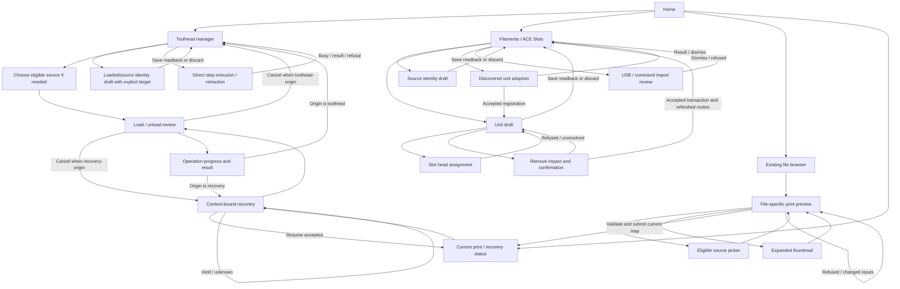

# Unified UI workflow and implementation-readiness review

Review date: 30 October 2026. Scope: current offline mockups, consolidated design,
WM+ native implementation, and separately reviewed openACE capabilities. This is
an implementation specification review, not printer or hardware acceptance.

## Managed ownership addendum — 11 November 2026

The [current plan, section 8](../ui-plan.md#8-command-boundaries-and-recovery-ownership)
and R20–R27 incorporate the [stock conflict audit](../upstream-client-callers.md#managed-behavior-conflict-audit--11-november-2026).
They supersede historical statements here that leave standalone recovery to stock.
Re-print enters fresh managed preview; public legacy filament operations share the
owner contract; PLR is admitted before preparation; reset/topology, factory editors,
failure retries, restart and print-Cancel callers require their stated ownership
boundaries. Initial fault detection and PAUSE remain active. The current
[acceptance checklist](standalone-completion.md) distinguishes deployed behavior,
known gaps and physical qualification. These added requirements are not a claim
that the conflicts have already been fixed.

## Current native coverage audit — 31 October

The earlier tables below describe the agreed workflow, not proof that every
native screen exists. Source review after removing the prototype full-screen
Runtime path establishes this current boundary. Hardware acceptance is incomplete. The 1 November walkthrough now supplies
stock-shell and selected ACE/preview framebuffer evidence; see
[native readiness](native-readiness.md). Some injected touches were missed,
and standalone, physical operations and the broader scenario matrix remain
unqualified.

| Workflow | Current stock integration | Remaining gap / preview boundary |
|---|---|---|
| Home | Stock shell/status retained; head routes and grouped ACE mini-view are hooked | Actual render/touch qualification, including mini-view overflow |
| Toolheads | Original filament card/colour/material reused; head tabs, temperature keypad, direct step actions, backend procedure review and standalone filament confirmation | Mounting evidence is displayed in the stock header (host-tested); Take/Dock is an explicit stub |
| Filaments | Original standalone cards; ACE scrolling groups, head filter, External sources, discovery banners | Visual fit and broad disconnected/unknown scenarios require qualification |
| Identity | Standalone stock pickers; ACE brand/colour drafts and typed exact-source Save/readback | ACE material selector is a disabled, stock-pane layout preview awaiting profile/temperature policy. Back explicitly discards; Toolhead origin return is implemented and host-tested. Leaving a hidden/reconstructed stock page consistently discards unsaved ACE editor drafts; submitted operations remain tracked |
| Unit details | Name via stock keyboard; per-slot and quick assignment previews | Only supported name save is connected; changed assignments cannot be committed as an atomic transaction |
| Adopt | Typed submission, context binding, receipt and registered-unit readback | Review slots → exact unit-details transition is implemented and host-tested |
| Remove | Idle-only preview confirmation within unit details | Current affected routes are now displayed; atomic removal and resulting tool-number plan remain unavailable |
| Import | Stock-content preview flow: source, example JSON/ZIP selection, summary, conflicts and results; Back/Close | Preview layouts only. Schema, real file listing, validation, conflict policy and backend import unavailable |
| Load/Unload and step actions | Backend-derived procedure/token, exact source choice, receipts; direct step busy/result handling; retained filament Result view | Stop/reconciliation shown as disabled controls; backend contract unavailable. Unknown outcomes remain held |
| Local-file preview | Original constructor/widgets, metadata, source selector, options, thumbnail expansion and admission/readback | Hardware and delayed metadata/file correlation qualification remain |
| USB-file preview | Stock preview adopted for worker inspection → explicit Copy → explicit Review local file; managed local mapping/admission follows | Runtime host integration, scoped independent review and ARM build pass; real USB/widget/metadata qualification pending |
| Recovery / active print | Existing V14 recovery integration and stock running-print UI retained | This is **not** completion of the newer unified recovery workflow |
| XYZ, Video, Wi-Fi, General, Files | Original vendor pages retained | End-to-end navigation and action-boundary acceptance remain |

Independent native review confirmed the Toolhead-return omission, missing
mounted-head display, missing removal-impact presentation, USB exclusion and
inconsistent dirty exits. Material/import/removal/assignment command gaps are
separate from these implementable UI gaps. The full goal remains incomplete.
See [native-readiness.md](native-readiness.md) for individual implementation and
validation records, including the exact candidate artifact.

## Decision

The visual hierarchy is a useful agreed baseline. The current mockups are **not a
complete executable workflow specification**. Begin shared shell, view-model,
read-only integration and individually supported adapter work. Do not start every
physical-action screen by translating the mock JavaScript into native code.

Keep the user's decisions: three sidebar entries; stock Settings tabs; separate
toolhead and filament/source destinations; direct manual Extrude/Retract with busy
feedback; simple identity editing; unit-only head assignments; no Devices, Slot
Assignments or Filament Library pages; grouped ACE sources and External sources;
idle-only confirmed removal with desired tool renumbering; USB/command imports.

This review supersedes inconsistent older workflow prose in ui-plan.md. Mockup
screens demonstrate layout and selected interactions; browser checks do not prove
complete flows, backend correctness, native integration or hardware acceptance.

## Required domain model

Keep these records distinct:

- Physical head: stable ID, availability, mounted/docked position, heater state.
- Source: stable ACE unit/slot ID or External head ID, configured identity and
  profile revision. Slot ordering and display labels are not tool IDs.
- Loaded material: backend-observed source and identity, confidence and operation
  context. Empty, loaded, unknown, loading and unloading are distinct states.
- Tool route: backend-assigned T number, physical head and source; revision.
- Editor draft: baseline revision, local modifications, pending save and outcome.
- Operation: ID, immutable head/source/intent/amount, origin, allowed actions,
  progress and complete/partial/unknown result.
- Print: file identity, sliced materials, validated source/tool map and revision,
  frozen mapping once accepted, print/recovery context and allowed actions.

Editing source metadata does not establish newly loaded material. Selecting a head
for browsing does not mount it. Unit slot numbering does not imply a virtual T
number. A request acknowledgement does not imply physical completion.

## Screen contents and transitions

| Screen | Required contents | Entry and exit | Missing specification or implementation |
|---|---|---|---|
| Home | Stock status, grouped source mini-view, discovery alert, current print/recovery summary | Head temperatures → Toolhead; mini-view → Filaments; Files → kept browser; active job → print/recovery | Real status binding, unknown/disconnected indication, mini-view overflow, active-job entry |
| Toolhead | Head tabs; loaded identity or empty/unknown; corner edit; Load/Unload; distance/heater; direct arrow actions; Take/Dock | Home or Filaments; edit returns to same head; operations return here unless recovery-owned | Correct loaded-source target, multi-source Load selector, touch keypad, actual mounted state, action concurrency |
| Filaments / ACE Slots | Head filter; titled units and slots; unassociated slots faded; External sources; Adopt/import | Home mini-view or Settings Filament; slot → identity; unit edit → details; Toolhead button | Multiple discovery candidates, all-unassigned/removed states, truthful connection state, stable IDs |
| Unit details | ID/name, four slot assignments, quick-fill, Save & exit, Remove | Unit edit; Back discards or asks about changes; Save returns to originating list position | Isolated draft, revision checks, changed-route impact, save/unknown response, name keyboard |
| Assign head | Current assignment, available heads, Unassigned option | Unit slot; choosing changes only draft; Back leaves draft unchanged | Unassign path, physical configuration constraints, unavailable heads |
| Identity editor | Brand including Generic; material; palette; preserve imported values | Named source or loaded-record edit; Save/readback or Back → exact origin | Loaded edit semantics, missing catalogue entries, retain exact custom colours, defaults and profile precedence |
| Adopt | Current candidate identity/name; explicit adoption | Banner → candidate/confirmation; success → new unit details; dismissal → Filaments | Multiple candidates, refreshed observation token, failure/unknown result, reconnection vs replacement |
| Remove | Unit and affected old/new tool routes; confirm/cancel | Unit details; success → Filaments; refusal → details | Backend atomic delete/renumber contract; active/paused admission; retained physical evidence |
| Import | USB file chooser or upload result; profile summary/conflicts; confirm/result | Filaments; success returns there with updated editor choices | Versioned JSON/ZIP schema, importer, command, validation and conflict policy |
| Load/Unload review | Backend-derived head/source/procedure and consequences | Toolhead or recovery; Cancel → origin; Begin → operation | Source selection, actual procedure/temperature, operation token; no hardcoded 80 mm |
| Direct Extrude/Retract | Selected step, bound head, busy pressed button, outcome/refusal | Toolhead; stays there; result belongs to original head even if browsing changes | Real progress/receipt, overlapping-action policy, unknown result; no review dialog |
| Operation result | Backend progress, permitted Stop, complete/partial/unknown, scoped next action | Bound operation origin retained through all subviews | Stop reconciliation, exact remaining work; never dispatch generic Extrude for a partial result |
| Recovery | Required frozen tool/source, allowed prepare/prime/confirm/resume, reasons held | Active-print pause entry; operation returns to same recovery; accepted Resume → active print | Reachable entry, phase transitions, source restoration, genuine resumed/held/unknown result |
| Print preview | File thumbnail/details; sliced colour/material/optional brand; chosen colour and route; options | Kept file browser; source popup returns to same row; thumbnail expands/closes | Real file metadata, validation/submission, no-op Start replacement, readback and accepted-print transition |
| Source popup | Same grouped ACE and External presentation; eligibility/reasons | Preview row; tap eligible source selects and closes; cancel preserves selection | Exclude unassigned/unavailable/incompatible choices as backend specifies; stable source IDs |
| Retained pages | XYZ, Video, Wi-Fi, General, files/history, active-print status | Existing navigation with clear ownership at action boundaries | Current mock placeholders do not implement or fully verify these pages |

## Complete flow map

All exits from dirty editors need one consistent save/discard/stay rule, including
sidebar and Settings-tab navigation. Every write stays pending until readback;
lost replies require reconciliation rather than blind retry. Read-only browsing
may remain possible during work, but active-operation identity stays visible.

## Admission and failure matrix

| Situation | Required behavior |
|---|---|
| Standalone, openACE definitively absent | Use WM+ physical-head adapter and External sources; never inherit hidden ACE numbering |
| openACE present, zero units | Still use openACE ownership; show External sources; absence of ACE hardware is not backend absence |
| Backend unavailable / stale | Label stale data, keep allowed read-only navigation, withhold new owned writes/motion; no stock fallback |
| Printing or paused | Remove disabled. Other topology/identity/motion controls follow explicit backend capability and current print context; do not infer safety from UI visibility |
| Busy operation | Bind progress to original head/source; reject overlapping incompatible actions; browsing must not retarget work |
| Partial physical result | Show backend-confirmed amount and only scoped permitted residual action; never reuse original manual step |
| Unknown physical result | Keep uncertainty visible, read status/reconcile, no automatic repeat or success timer |
| Draft versus changed backend revision | Refresh/reconcile or reject stale save; preserve user draft for review |
| Route/identity change after preview | Invalidate/revalidate affected mapping by revision; don't retain copied labels as authority |
| Removal | Backend returns coherent new registry; invalidate stale selections, show changed tools; do not erase loaded/recovery evidence |

## Confirmed defects in the present mockup

These are design-prototype defects, not evidence that the installed printer does
these things. Independent reviewers reproduced them by source inspection.

1. `state.slots` aliases ACE 1 identities, External identities and loaded head
   identities; toolhead edits dispatch `edit-manual` regardless of actual source.
2. Unit quick-fill, slot and name edits mutate live state; sidebar exits bypass
   cancellation; third-unit restoration is incomplete.
3. Partial `progress()` uses `op:Extrude`, now a direct action, rather than an
   operation-bound remaining-work review. This is a blocking specification defect.
4. Recovery is accessible through reviewer navigation but lacks real job entry;
   prepare/prime lose their origin through progress and no resumed state exists.
5. Preview uses array-derived T IDs, permits unassigned sources, copies labels
   rather than source references, and never submits a print.
6. Load does not select a source when several slots feed the selected head.
7. Busy arrows do not establish a complete action-admission matrix. Loaded state
   has no unknown state, Take/Dock is explanatory text, and numeric/text editors
   rely on browser controls rather than a printer keyboard.
8. Plan diagrams and mock metadata retain superseded library, Devices and review-
   every-operation language. They must not be used as independent specifications.

## Implementation sequence and gates

1. **Start now:** native shell integration, reusable cards/tabs/modals/keypads,
   navigation and origin model, independent domain records, mock-backed fixtures,
   capability/read-only status adapters. Preserve installed implementation inputs.
2. **Existing-command slices:** discovery/readback, supported identity fields,
   individual route commands and rename/adopt adapters can be implemented against
   existing contracts. Extend missing Brand support in WM+; don't invent a new
   openACE command merely because its UI adapter is narrow.
3. **Before operational screens:** agree generic physical-operation intent,
   admission, operation ID/progress/result and stop/reconcile semantics for both
   ownership modes; retain recovery origins and loaded identity evidence.
4. **Before preview/start:** file metadata, authoritative tools/source IDs,
   compatibility reasons, revision-bound validation/submission and job transition.
5. **Before topology Save/Remove:** unit draft transaction policy and explicit
   cascading removal/renumber operation with active-print refusal/readback.
6. **Before import:** versioned format, USB/upload implementation, supported fields,
   conflict rules, catalogue refresh and retained custom-field semantics.
7. **Before deployment:** source/artifact binding, native widget and touch checks,
   current-client ownership, preserved Stop/Cancel access, operator-approved idle
   activation and attended acceptance. Browser checks alone do not pass this gate.

For each implemented slice exercise success, refusal, stale data, lost reply,
partial/unknown work, navigation away/back, repeated taps and capability changes.
Use standalone, openACE-zero-unit, multi-unit, disconnected and active/paused job
fixtures. No printer actions were performed for this review.

## Independent review record

Three independent reviewers audited UX, workflow/state correctness, and native/
openACE capability readiness. All independently concluded that foundation work
can start but complete operational implementation is not ready. Backend review
adds that supported typed-command adapters can begin alongside the shell, subject
to normal context, readback and acceptance gates. See the separate [openACE capability audit](openace-capability-review.md) and
[WM+ capability audit](wmplus-capability-review.md); installed/hardware validation must not be
inferred from source presence.

## Outstanding product decisions versus engineering contracts

- External display: the requested rule is one External slot for a head with no
  ACE assignment. openACE also supports an existing direct tool on an ACE-capable
  head. Preserve that tool and loaded provenance in the model; decide how such
  existing direct tools remain selectable without misleading the simplified list.
- Loaded-card edit: choose whether edits target the source's configured identity
  or a separate correction of currently loaded evidence. They are not interchangeable.
- Hidden temperature: a material/profile change needs a preserve/default policy;
  a brand/material selector must not silently retain an unsuitable temperature.
- Tool aliases: multiple T entries may address one source. Preview selection must
  use a backend-selected or explicitly chosen eligible tool, not UI array order.
- Ordinary route changes and active-print admission must be specified alongside
  idle-only removal; a frozen map does not by itself make physical rerouting safe.

These decisions do not block shared rendering or read-only implementation. They
block the relevant write/motion flows and should be resolved in the corresponding
contract slice before production activation.

Final UX re-review agreed with the conclusion, requesting the explicit loaded-card
edit/return edges and an unresolved-policy note for coexisting direct/ACE tools.
Both corrections are incorporated above.

The final WM+ native-capability re-review also agrees with the implementation
boundary. The three reviewers reached consensus on readiness and blockers; the
product choices listed above remain explicitly unresolved rather than assumed.

See the [filament motion side-effect audit](../filament-motion-audit.md) for the
confirmed EXTRUDE_FILAMENT purge/wipe/dock chain and why generic distance steps
need a distinct operation contract.

## Implementation follow-through (31 October 2026)

The first shared C++ controller and screen layouts are now in
[`client-preload/unified-ui`](../../client-preload/unified-ui/README.md), with a
local preview that runs the same controller, typed management adapters, and
explicit backend stubs. The linked README records screen-by-screen coverage and
the remaining production port/live-projection work. This does not activate or
replace the installed touchscreen.

Independent follow-up reviews identified and drove fixes for recovery head
binding, dirty editor exits, loaded-source targeting, control request tracking,
session-bound receipts, terminal save reprocessing, cancellation context drift,
and picker navigation. These are covered by the host/controller and typed
queue tests. The prior deployment/hardware gates still apply.
