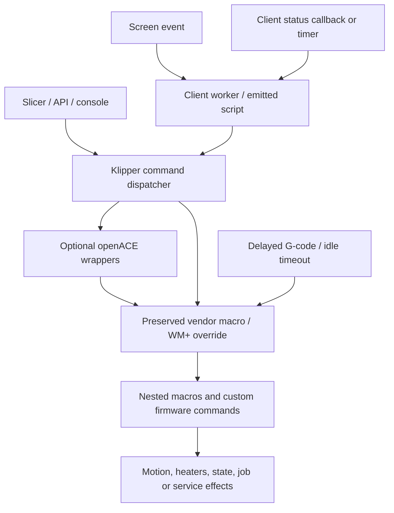

# Vendor command behavior and caller audit

30 October 2026. Offline review of System 1.1.13 baseline `config/stock`, current
WM+ `config/live`, and available client disassembly/decompilation evidence. No
printer commands or activation performed. This inventory describes possible
execution paths; it does not establish the exact installed incident trace.

## How to use this audit

- [Stock definition inventory](command-audit/stock-inventory.md): all 133 macro,
  delayed-G-code, homing-override and idle-timeout definitions in the snapshot.
- [WM+ live inventory](command-audit/live-inventory.md): all 148 corresponding
  definitions in the working tree; includes uncommitted work.
- [Machine-readable graph](command-audit/macro-inventory.json): definitions,
  source locations, direct commands, macro callers, possible transitive effects,
  unresolved dynamic lines and source hashes.
- [Screen-client callers](upstream-client-callers.md): screen events, worker
  callbacks and autonomous paths, with evidence strength and remaining gaps.
- [Calibration, homing, settings and job review](upstream-command-nonfilament-review.md).
- [Detailed filament motion audit](filament-motion-audit.md).

Regenerate the static inventory with `python3 tools/audit_macro_effects.py`.
It does not execute templates, import printer code, access credentials or connect
anywhere. Snapshots and source binaries are not modified or copied into the report.

## Findings: command names are not reliable descriptions of scope

| Entry point | Actual behavior / hidden contract | What can call it |
|---|---|---|
| EXTRUDE_FILAMENT | Stock default E100, service travel, fan/heater changes, cooling to160, wipe, then dock/unlock. Does not consume a generic requested distance. | External caller or screen-generated script; openACE purge wrapper explicitly calls previous handler under assist. Client-specific trigger evidence is in caller audit. |
| RETRACT_FILAMENT | Stock travel X-13 Y232 then E3,-20,+10,-50 (net -57), dwell and modal changes. WM+ replaces with service clearance and material-dependent tip shaping/cooling/wipe. | External/UI wrappers; openACE routes retract role as unload on ACE-fed heads. Not a negative distance jog. |
| LOAD_FILAMENT | Activate an extruder, heat, long feed (default100), heater off, disable selected stepper. Activation is not physical pickup. | Screen/UI or wrapper. openACE may select a mapped source instead. |
| UNLOAD_FILAMENT | Stock heat and E2/E-45, heater off, stepper disable; WM+ material tip shaping changes extraction. | Screen/UI or openACE wrapper. Loaded-source ownership matters. |
| PARK_CURRENT_TOOL | Returns/releases physical head using _UNLOCK_TOOL; failure retry may home XY. | Stock EXTRUDE_FILAMENT statically calls it; external callers remain possible. |
| GET_TOOL_POSITION | Hardware position query, unconditional G28 XY, then X150 Y200. | No static macro caller found; absence of a macro caller is not evidence of disuse. |
| T0–T3 / _CHANGE_TOOL | Validations, possible home, physical unlock/lock, offsets, checks and retry. Homing check precedes same-head branch in _CHANGING_TOOL. | Slicer, screen scripts, macros, API; openACE replaces public virtual T namespace. |
| WIPE_NOZZLE | May home XY, then travel and wiping strokes. WM+ also has state/clearance handling. | Purge and calibration/tool workflows; inspect static callers and current include order. |
| G28 / calibration / timelapse | Composite effects extend beyond the apparent primitive command. | Screen requests, macro calls, slicer, delayed callbacks and Moonraker; detailed review linked above. |

A name that sounds narrow is not automatically wrong: a calibration can reasonably
need preparation. The problem is invoking a composite workflow where the caller
intends a primitive action, or repeating preparation despite valid state.

## Caller layers that must remain distinct

The client sometimes emits an entire sequence instead of one public macro. A
macro override cannot suppress an independent client G28/G1. Conversely, the
same macro can be reached without any screen action. Recovery callbacks must not
be attributed to operator taps unless the event chain is actually established.

## Audit interpretation and coverage limits

The inventory covers every relevant definition in the two flat cfg directories,
not every command implemented by Klipper or vendor extensions. It includes test
macros and optional modules whether or not a particular runtime includes them.
`printer.cfg` include order and duplicate definitions matter: inventory rows are
potential definitions, not a resolved runtime dispatcher. Duplicate names are
retained and transitive effects conservatively union their bodies.

Jinja branches are not executed. A possible effect is not an unconditional effect.
Dynamic macro names, action helpers, delayed scheduling targets, vendor C/Python
commands, shell-command bodies and custom hardware commands need separate manual
tracing. The JSON retains leaf commands and dynamic-line locations for that work.
The scanner does not bind G28 to homing_override, rename_existing aliases to
original handlers, or UPDATE_DELAYED_GCODE IDs to delayed targets; the manual
review covers those high-impact paths. An empty effect column does not certify a
command as read-only.

Macro caller edges are lexical static calls, normalized case-insensitively.
Client callsites require independent binary evidence. Strings/symbols alone prove
existence, not trigger conditions or exact emitted ordering. Historical traces
are labelled by version; they do not automatically qualify 1.1.13 behavior.

## Prioritized follow-up

1. Keep manual E steps separate from purge/load/unload macros. Implement shared
   exact-distance ownership/admission/progress rather than reusing ambiguous names.
2. Complete the incident's actual emitted timeline: the purge/dock chain is
   confirmed by source, but reported pickup, home trigger and wall-contact cause
   still need correlation with installed state and logs.
3. Audit ordinary same-head selection and successful service finishing for redundant
   preparation. Failed exchange retries require explicit recovery policy, not a
   blanket “homed already” bypass.
4. Keep screen runout/resume worker ownership guards separate from macro changes;
   they cover independent sequences and autonomous triggers.
5. Mark query-sounding motion commands in user/API documentation and any new UI.
   Preserve legacy behavior until callers and replacements are identified.
6. Implement override changes as individually reviewed contracts with generated
   command-trace tests and later authorized hardware acceptance. No global G28/G1
   suppression, and no inference that a collision leaves coordinates trustworthy.

This report is a broad source inventory plus reviewed high-impact paths. Remaining
uncertain client triggers and custom-command internals are explicit gaps, not a
claim that every upstream runtime behavior has been proven harmless or fully traced.
